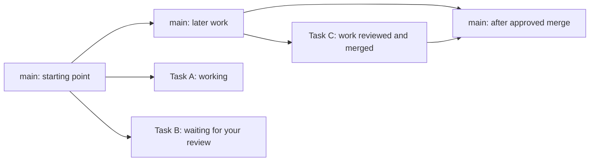

# Branch workflow in Queue-tea

Design for the reopened **Task description** task, following Rohan's clarification on 4 November 2026.

## What the user should be able to do

Open Branches, see where work split from the project's integration branch, see which agents are actually working, and bring completed work back through a review and merge flow inside Queue-tea. The user should not need to understand worktree folder paths or paste Git commands to complete the normal flow.

The interface looks like a branching tree, with a persistent main line and connected task lanes. Git permits several children and later joins, so the underlying model is a graph rather than a binary tree. The view must show real ancestry and confirmed merges; task grouping alone is not evidence of a Git relationship.

## What exists and what needs replacing

The 1.5.2 source at commit `7bbbd01` has a Branches page with cards grouped by their recorded base. Its Merge instructions dialog checks Git and provides shell commands. It does not execute a user-approved merge, show a commit graph, or provide conflict resolution.

This task's branch is based on the older 1.2.x source and contains the new activity recorder. The newer application also supports concurrent tasks, Codex, worktrees, and version 2 records. Implementation must preserve those capabilities. Integrate the source histories before extending the live Branches page; do not install this older task branch over the newer app. Rohan committed the initial integration as `c493e86` and installed it. The 5 November completion work is a separate uncommitted change on `task/task-description`.

## Screen layout

- **Top bar:** project, integration branch, last local Git observation, filters for working / needs review / blocked / merged, and Refresh. A Fetch action is separate and explicit when remote information is needed.
- **Graph:** the integration branch is the stable trunk. Each task has a lane starting at its actual fork. Commits appear along it; successful merges connect back to the destination. Pan, zoom, fit, and focus-active controls support larger projects. Keep lane positions stable during live updates.
- **Branch node:** task title, branch, agent, state text and icon, changed-file and commit counts, latest action, and time last observed. Opening a node selects it without changing any checkout.
- **Detail drawer:** Overview, Changes, Checks, and Activity. Show source and destination branches clearly. File diffs and exact test commands/results belong here. Folder paths remain available under advanced details or Open folder.
- **Primary action:** changes with the branch state: Open session, Resume, Review work, Resolve conflicts, Review & merge, or View merge. Never suggest Merge as the action for an agent that is still writing.

Example topology, where work and merge states come from observation:

## Status and motion

Task progress, Git integration, and remote publication are separate facts. A task marked done does not prove it was merged; a merged commit does not prove it was pushed.

| Visible state | Evidence | Appearance and primary action |
| --- | --- | --- |
| Queued | Task exists, no work started | Quiet node; Start |
| Working | Fresh session reports an executing turn or operation | Gentle pulsing ring and latest observed action; Open session |
| Waiting for you | Session asks a question or approval | Attention icon and reason; Respond |
| Paused / session unavailable | No fresh execution signal | Steady node, last-seen time; Resume or reconnect |
| Ready for review | Agent submitted its result or the user ended work | Amber badge; Review work |
| Changes to commit | Worktree has uncommitted changes | File count; Review changes and user-controlled commit |
| Checking merge | User opened a merge preview | Progress indicator and named checks |
| Conflicts | Git reports incompatible changes | Red badge with file count; Resolve conflicts |
| Ready to merge | Reviewed source, clean relevant worktrees, merge preview is current | Review & merge |
| Merging | User approved this operation and it is in progress | Progress steps; prevent duplicate submission |
| Merged locally | Recorded merge result is verified in the target ancestry | Solid return connection; View merge / Review push |
| Published | A successful push is observed, or fresh remote data confirms the commit | Remote/branch and confirmation time |

Pulse only while work is actually observed. Selecting a task, assigning an agent, or retaining an old session must not animate it indefinitely. Several agents can work simultaneously. Reduce Motion and Calm mode replace animation with a steady icon and text. Status must remain understandable without color or motion.

For Codex, a stored handover time is not evidence that the agent is currently working. Add an instrumented runner or supported session-event adapter for commands, file changes, output, and checks. Until observation exists, explicitly show that activity is unavailable; do not infer passing tests from assistant prose. Keep Claude Code's existing tool-event recorder.

## The user-approved merge flow

1. **Review work.** Open the source branch's changes, commits, and checks. Show the exact commit checked and mark results stale when the source changes. The user can send work back or continue to the merge preview.
2. **Commit pending work if needed.** Offer selected files, their diffs, and an editable message in the app. Only the user's explicit Commit action can create this commit. Do not stage unrelated work automatically. A local merge does not require the branch to have been pushed.
3. **Choose the destination.** Start with the recorded base when it exists, and show `task/name → main` prominently. Do not assume the main project folder is on the target branch. Discover its owning worktree or prepare a dedicated integration worktree. Do not switch a worktree being used by another task.
4. **Preview.** Check that refs exist, source and target worktrees are suitable, no other operation owns the destination, no source agent is still writing, and the merge is possible. Show changed files, commits, expected result, and any conflicts. Local checks do not claim remote freshness.
5. **Approve the concrete result.** Show source and destination, current commit IDs, checks, and the proposed merge message. The button says `Merge task/name into main`. Use a normal merge preserving branch history as the first supported strategy. Do not silently squash, rebase, or push.
6. **Recheck and merge.** The main process verifies the project, task, refs, worktree ownership, and the source/target commit IDs again immediately before changing Git. If the preview is stale, ask the user to review the refreshed result. Serialize merges to the same destination and reject repeated requests.
7. **Report the result.** Show each operation as it occurs, then the actual merge commit and target branch. Connect the task lane back to the target only after Git confirms it. Preserve branches and worktrees by default.
8. **Publish separately.** If requested, show the exact remote, target branch, and outgoing commits before a separate Push action. Authentication, protection rules, rejection, and offline failures leave the local merge intact and clearly labelled.

An agent's permission to edit a task never grants it permission to commit, merge, or push. The app's existing blanket Git guard needs a narrowly scoped path for actions explicitly initiated and confirmed by the user, with validation in the main process. Do not expose an arbitrary shell-command IPC endpoint or simply remove the guard.

## Conflicts and recovery

- Show conflicting files with a three-way comparison: common base, destination, and task changes, plus an editable result. Label the branches by name instead of ambiguous ours/theirs terms.
- Keep conflict resolution in an isolated integration worktree. Do not overwrite the task's working copy or another agent's files.
- Stage only user-resolved files. Show unresolved markers and remaining conflicts. After resolution, run the agreed checks and present the final merge message before completion.
- Offer a clear Abandon merge action with a concrete explanation of which merge-resolution changes will be discarded. Never auto-stash, reset, force-push, or delete branches.
- On restart or IPC failure, inspect Git and the saved operation record before offering Retry. A completed merge must not be executed a second time merely because its response was lost.
- Reopening an unmerged task resumes its retained branch and history. If its work has already merged, offer a follow-up branch from the destination and keep the previous merge visible.

## Keep the app update tied to integrated source

The current commit hook can package whichever worktree made the commit. That allowed the task's older 1.2.1 build to replace the installed 1.5.2 app. The GUI must make the release path explicit:

`work → review → user-approved merge → validate integrated source → build → update available → restart`

Feature-branch commits may build previews but must not replace the production installation. Record the build's source commit and integration ref. Before replacing the installed app, verify that the candidate includes the installed source history; comparing version numbers alone is insufficient. An intentional rollback requires its own explicit choice. Keep the previous application available until the replacement launches successfully. Saved records and active task sessions must survive the restart.

## Data and implementation boundaries

- Preserve version 2 project records and all worktree/platform/helper fields when integrating the activity recorder.
- Keep task execution, review, merge operation, and publication status separate. Add a durable operation record containing source and target refs, expected commit IDs, timestamps, stage, result commit, and any recovery details.
- Read Git ancestry and worktree ownership in main; let the renderer receive a typed graph and status model. Show uncertain or unavailable data explicitly instead of inventing edges.
- Extend the existing merge preview API into a preview/result model. Execution accepts a validated preview reference, not a free-form command or caller-supplied filesystem path.
- Keep graph layout, status derivation, and source comparison as independently testable functions. Use native SVG/HTML for the graph, with keyboard navigation and an equivalent branch list for assistive technology and narrow screens.
- Reuse the task activity events for the detail drawer. Keep bounded output, stable event IDs, and the distinction between a launched process and its eventual result.

## Acceptance checks

1. Two concurrent tasks fork from the correct base and appear in separate connected lanes. Actual nested branch ancestry is distinct from task/saga grouping.
2. Only tasks with fresh working evidence pulse; stopped, paused, or disconnected sessions stop pulsing. Reduce Motion works.
3. A finished task asks for review and remains visibly unmerged until Git confirms integration.
4. Review, file diffs, check evidence, merge preview, conflicts, confirmation, and merge result are available in the GUI without copying commands.
5. Changing either branch after preview invalidates approval. A dirty destination, active writer, missing ref, or existing merge blocks execution with a useful recovery action.
6. A successful merge displays its message, commit, and destination and draws the return connection. A lost response or restart cannot create a duplicate merge.
7. Conflicts can be resolved or abandoned without overwriting another task's work. The user reviews the resolved result before committing it.
8. Local merge and remote push are distinct. Push failure never removes the local work or reports it as published.
9. Feature-branch commits do not install over the current production app. Integrated builds preserve installed source history and have a recoverable restart path.
10. The existing Claude/Codex and concurrent-worktree features remain functional. Commands and test results are only shown when observed by a supported adapter.

Tests for merge execution must use disposable repositories. Under this task's current operating restrictions, the assistant must not itself execute commit, push, merge, rebase, reset, or branch-changing integration commands; those checks require the owner's authorization before they are run. Read-only inspection, UI tests with fakes, and the design itself can proceed without them.

## Implemented flow and validation

The Branches page now reads actual local Git commit parents, shows several task lanes, and opens a review panel with Overview, Changes, Checks, and Activity. A fresh executing session pulses; Codex observation is a local JSONL adapter with a 90-second freshness limit. It reads native nested command and file-change events, correlates background results, and discovers resumed sessions by modification time regardless of their original date. It reads appended bytes incrementally. Unsupported or unavailable events are labelled unavailable. No remote is contacted when opening this screen.

Selected-file commits, isolated merge preparation, three-way text resolution, final merge approval, and a separate remote review/push are typed main-process operations. The generic agent Host still refuses commit/merge/push. Operation records under `~/.queue-tea/integrations/<project>/` retain commands, bounded output, reviewed heads, the prepared result, and publication evidence. The app serializes operations, rechecks heads and working folders, and recovers an already-created merge commit before retrying an interrupted apply. Branches and task folders are retained.

Large/binary conflicts can select a whole regular-file side; symlink/submodule conflicts require an editor in the retained integration folder. The review discovers configured npm checks from the prepared Git tree. The user selects and starts checks in the GUI; output streams live, cancellation stops the process group, and stored results identify that tree and check definition. Failed/cancelled/interrupted results and changed prepared files block merging until a passing retry. Compatible installed dependencies are reused; checks do not install packages. Older observed agent checks remain labelled as historical evidence. Git commits/merges/pushes also stream output, and the task pane polls Codex activity every second.

Automatic refresh exits before build/dependency work for feature, detached, or dirty checkouts. Packaged builds carry source provenance; installation requires integrated, clean source that contains the installed history. The previous application is retained under a timestamped hidden name in Applications. For the first upgrade from an older app without provenance, the owner must identify its source commit and set `QUEUE_TEA_ADOPT_INSTALLED_COMMIT` for that installation. For the restored 1.5.2 installation in this session, that source was `7bbbd01789b87b2b57685fffeeaa59457c552ba4`.

Real Git workflow tests are opt-in: `QUEUE_TEA_GIT_TESTS=1 node app/node_modules/vitest/vitest.mjs run --root app main/features/branches/api/branch_integration.spec.ts`. These run only against disposable temporary repositories and a local bare remote. The owner approved this exception for this task. Only the completion changes remain uncommitted; the initial foundation was committed by Rohan.
