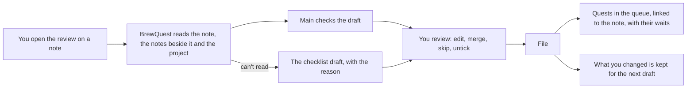

# BrewQuest: from a note to quests

BrewQuest is the robot in the Notes editor's foot. Press **Turn into quests…**, or drag the robot onto a note, and it reads the note with Claude Code, then drafts quests for you to review. You change what you like and press **File**. Nothing reaches the queue before that press.

Before Q09, BrewQuest made one quest per unticked `- [ ]` line. That checklist draft is still there: it is what you get when Claude Code can't read, and what **Use the checklist instead** gives you at once.

This page covers Q09, "BrewQuest — Knowledge-to-Quest Intelligence". Its drawing is in [brewquest.pen](brewquest.pen). The Notes page itself is in [notes.md](notes.md).



## What it reads

The app runs Claude Code in the realm's folder:

```
claude -p --agent queue-tea:brewquest --disallowedTools Bash,Edit,MultiEdit,Write,NotebookEdit,WebFetch,WebSearch,Agent,Task --output-format stream-json --verbose -- <order>
```

The helper is defined in `agents/brewquest.md`. It may use **Read**, **Grep** and **Glob** only. The command line refuses every tool that writes, runs a command or goes online, even where your own Claude Code settings allow it. BrewQuest is not a Guild Hall member, so it has no card in the Guild and no chats in the codex.

The order (`app/main/features/brewquest/domain/brew_brief.ts`) gives it:

- **The note**, cut at 40,000 characters.
- **The notes beside it**, when **Read the notes it links to, and that link to it** is ticked (it is by default). That means the notes it links to with `[[…]]`, then the notes linking to it, at most five, never archived ones, each cut at 8,000 characters.
- **The realm's quests**, open ones first, at most 400, one line each with id, state, priority, title, parent and the start of the description. Removed quests are left out.
- **The project's own explanations**, by name, from `CLAUDE.md`, `AGENTS.md`, `README.md`, `docs/architecture.md`, `docs/spec.md`, `docs/roadmap.md` and `docs/plan.md`, when they exist. BrewQuest opens them itself.
- **What past reviews showed** (see [Learning from your reviews](#learning-from-your-reviews)).

It answers with one fenced `brewquest-draft` block of JSON. The format is spelled out in the order. A run that goes past 8 minutes is stopped.

While it reads, the sheet shows the robot thinking, "BrewQuest is reading the note and the project. Nothing is filed until you press File.", and what it is doing now, from the same stream the Guild uses ("Reading CLAUDE.md…", "Opened 3 files or searches so far."). **Use the checklist instead** stops the read. So does closing the sheet. One read runs at a time in a realm, and app updates wait for it to finish.

## What main checks before you see it

`app/main/features/brewquest/domain/brew_reply.ts` reads the block and keeps only what can be shown and filed safely:

- **Keys.** Each quest and group gets a key of the draft's own, such as `d-mwxkpcusab12.q2`. Main never uses the keys BrewQuest wrote.
- **Parents.** A group may go under a quest already in the realm only when that quest is open and is not itself under another. Otherwise its quests stand alone, with "BrewQuest put this under a quest that's done or is itself under another, so it stands on its own for now." A new parent needs a title.
- **Values.** Priority, difficulty and effort points outside the allowed values fall back to mid, medium and the nearest step of 1, 2, 3, 5, 8 or 13. Text is trimmed and cut to its limit. Criteria are deduplicated, at most 10.
- **Sources.** Each quote is checked against the note it names. Words that aren't there are kept, marked "These words aren't in the note as quoted; check them before filing."
- **Checklist lines.** A quest keeps the line it came from only when that line is an unticked line of the note.
- **Matches.** A match BrewQuest gave is kept only for a quest still in the realm. Every other quest is compared by title too: most of the same words is **Already a quest**, two or more shared words is **Overlaps**.
- **Waits.** A wait names a key in this draft or an open quest's id. A wait that would loop is left out, with "Waiting for “…” was left out, because the two would wait for each other."
- **Size.** One review files 50 quests at most. The rest become a question: "BrewQuest drafted 3 more quests than the 50 one review can file. …"

## When it can't read

The sheet shows the checklist draft instead, with the reason in a banner above it:

| What happened | What the banner says |
| --- | --- |
| Claude Code has no `queue-tea:brewquest` helper | Claude Code doesn't have BrewQuest yet. Update the queue-tea plugin in Claude Code, then read again. Until then, here's the checklist. |
| `claude` isn't installed | The app couldn't find Claude Code, so this is the checklist. Install Claude Code, run claude once in a terminal to sign in, then read again. |
| It ran past 8 minutes | BrewQuest read for 8 minutes without finishing, so it was stopped. … |
| You stopped it | You stopped BrewQuest, so this is the checklist instead. |
| It failed, often because it isn't signed in | BrewQuest couldn't finish reading, so this is the checklist. Check that Claude Code is signed in by running claude in a terminal, then read again. |
| Its answer had no draft the app could read | BrewQuest's answer wasn't a draft the app could read, so this is the checklist. … |
| The realm's folder is gone | The realm's folder isn't at … any more, so BrewQuest couldn't read the project. Here's the checklist. |

**Read again** tries Claude once more. The window keeps a Claude draft for 30 minutes while the note's text stays the same, so closing and reopening the sheet doesn't read again.

## The review

The sheet lists the draft group by group:

- **Under a quest already in the realm.** "Under Sidebar polish", with BrewQuest's reason.
- **Under a new parent.** The parent's title is a field, with a box to file it. Untick it and its quests stand alone.
- **On their own.**

Above the groups, "Read as: …" says what BrewQuest took the note to be about, and "It read 2 notes and 3 project files." **Decide before filing** lists its questions and the context it couldn't find. **From your last reviews here** shows what it was told about past reviews.

Each quest has a box to file it, its title, priority, difficulty and **Effort** in points. **Details** opens:

- **What quest N is for**, which opens the quest's description.
- **How to tell quest N is done, one per line**, the acceptance criteria.
- **The note's words** it came from.
- **Not confirmed yet**, BrewQuest's doubts.
- What it waits for.
- **Merge quest N into**: files it as part of another quest. Its criteria, words and doubts go with it, and the other quest's description says "It also covers: …". A quest that others are merged into can't be merged itself.

A quest that is **Already a quest** starts unticked. **Keep both** ticks it, **Skip it** unticks it again. Fields are checked when you leave them and when you press **File**. ⌘↩ files, Esc cancels.

## Filing

**File** sends the review to `fileNoteQuests` in `app/main/features/notes/api/notes_api.ts`. It files each quest through the quest engine, group by group, under its parent, and links each to the note as soon as it is in, with its key and the quest it went under. The note's front matter then reads like:

```yaml
quests: [{"id":"t-1","item":null,"key":"d-mwxkpcusab12.g1","under":null},{"id":"t-2","item":null,"key":"d-mwxkpcusab12.q1","under":"t-1"}]
```

A quest whose key the note lists already is skipped, so **Try again** after a failure part way never files one twice. Once every quest is in, waits are set with the quest engine's **Waits for**. A wait on a quest that is done, removed or would loop is left out, and the toast says how many.

A filed quest's description says where it came from, then what it's for, then the note's words, its effort and what isn't confirmed:

```
From the note "Threat model" in Notes.

Know what could go wrong.

The note's words:

> What could go wrong.

Effort: 5 points (BrewQuest's estimate).

Not confirmed yet:
- Which scale to rank by?
```

The quest board has no effort field yet, so effort lives in the description (Q11's PR adds one).

## Learning from your reviews

Each filed Claude draft keeps what you did with it in `~/.queue-tea/brewquest/<realm key>.json`: how many quests it drafted, the titles you turned down, how many you merged or left to a quest already there, and each priority, difficulty or effort you changed. The last 20 are kept. Checklist drafts are not.

The next read in that realm is told a few plain lines made from them, such as:

- Rohan reviewed 3 drafts with 11 quests in this realm.
- He turned down 2 quests, such as "Add a settings page".
- He raised the effort points 3 times, as on "Count terminal time" (3 to 5).

The same lines show under **From your last reviews here**, so you can see what it was told. They only shape the draft: nothing is filed or skipped because of them. To forget them, delete the file.

## Limits

| What | Limit |
| --- | --- |
| Quests one review files | 50 |
| Groups | 12 |
| Criteria a quest | 10, each 300 characters |
| What it's for | 2,000 characters |
| Sources a quest | 4, each quote 500 characters |
| Doubts a quest | 6 |
| Questions, and context it couldn't find | 8 each |
| Notes beside it | 5 |
| A run | 8 minutes |

## Where the code is

| Part | Where |
| --- | --- |
| The draft's types, keys, title matching, the checklist draft and the notes beside one | `app/shared/brew_draft.ts` |
| The helper | `agents/brewquest.md` |
| The order, the answer's checks and the lessons | `app/main/features/brewquest/domain/` |
| The run | `app/main/features/brewquest/api/brewquest_api.ts` |
| Kept reviews | `app/main/features/brewquest/data/outcome_store.ts` |
| Filing | `app/main/features/notes/api/notes_api.ts`, `app/main/features/notes/domain/quest_description.ts` |
| The review's state and checks | `app/renderer/features/notes/domain/brew_review.ts` |
| The sheet | `app/renderer/features/notes/presentation/widgets/brew_quest.tsx` |
| End to end, with a stand-in `claude` | `app/e2e/notes.e2e.ts`, `app/e2e/fake_brewquest.ts` |

## Q09's child quests

| Child | State | Where |
| --- | --- | --- |
| Q09.1 Helper architecture | Done | `agents/brewquest.md`, run on its own, outside the Guild |
| Q09.2 Character design | Done before | [BrewQuest's moods](notes.md#brewquests-moods) |
| Q09.3 Interactive companion | Done before | [Drag BrewQuest onto a note](notes.md#drag-brewquest-onto-a-note) |
| Q09.4 Realm understanding | Done | The order: project files, the quest list, the notes beside it; **Couldn't find** |
| Q09.5 Note interpretation | Done | "Read as", doubts, **Decide before filing** |
| Q09.6 Quest decomposition | Done | Groups under a quest or a new parent, waits |
| Q09.7 Duplicate detection | Done | BrewQuest's matches and title matching, **Keep both** and **Skip it** |
| Q09.8 Effort estimation | Done | Priority, difficulty, effort points, criteria, doubts |
| Q09.9 Review workspace | Done | Edit, merge, skip, untick, then **File** |
| Q09.10 Backlog integration | Done | The quest engine files and sets waits; keys make a retry safe |
| Q09.11 Note traceability | Done | The description quotes the note; the note lists each quest with its key |
| Q09.12 Multi-note analysis | Done | **Read the notes it links to, and that link to it**; sources name their note |
| Q09.13 Guild Hall integration | Left | BrewQuest opens from Notes only |
| Q09.14 Feedback learning | Done | Kept reviews and the lines they make |
