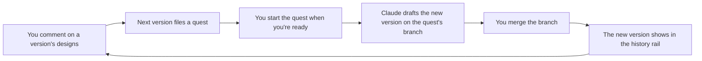

# Designs tab

Spec for the **Design Tab** task, from the screens in `docs/design-tab.pen` that Rohan approved on 5 November 2026.

## What the user should be able to do

Open **Designs** (after Quests, ⌘3) and see the designs of the selected realm. A history rail on the left lists the realm's design versions, newest first, and the page opens on the newest one that reads. Clicking another opens its designs as cards. Opening a card opens an editor where frames move and resize, text is edited, and fills, colours and corners change, with undo, redo and autosave. Every design has a comments box. **Next version…** turns a version's open comments into a quest, and when that quest runs, Claude drafts the next version from them.

A version's label is free text. `5.4.3`, `v5`, `Onboarding pass 2` and `First sketch` are all fine. The rail orders versions by when they were made, not by their labels.



## Decisions

- **Claude drafts versions as files; Rohan refines them in the app.** The tab never starts Claude Code. Next version only files a quest, so it can't collide with a quest that is already running.
- **Designs live in the realm's own repository**, in `docs/designs/`, so git keeps their history and Claude writes them without permission prompts. Editing in the app leaves uncommitted files, and Queue-tea holds Start until they are committed, as it does for any change.
- **Only merged versions show.** The tab reads the realm's own folder. A draft on a quest's branch appears once that branch is merged.
- **Next version needs at least one open comment.** With none, pressing it says "Add a comment first: the next version is built from your feedback." and files nothing. The first version of an empty realm is the exception (see the empty state).
- **⌘3 opens Designs.** Branches moves to ⌘4, Chronicle to ⌘5, Mana & time to ⌘6.
- **Mocha Mockup knows the format.** `agents/mocha-mockup.md` teaches it. The quest turns on Mocha Mockup as well as Tea-DD, and its description names Mocha Mockup, so Claude can ask it for files the editor can open.
- **Backup copies stay out of the realm.** The last good copy of each file is kept at `~/.queue-tea/designs/<realm key>/<version folder>/<file>`. A copy beside the file would count as an uncommitted file and hold Start.

Rejected: opening Claude Code or copying a prompt for Next version, because either could collide with a running quest. Storing designs beside or inside the record, because that brings permission prompts and loses git history. SVG, HTML or Pen files as the format, because they are hard to edit safely or are encrypted.

## Files on disk

```
<realm>/docs/designs/
  5.4.3/
    version.json
    comments.json
    welcome.design.json
    pair-your-insoles.design.json
  onboarding-pass-2/
    ...
```

A version's folder is its label, lower-cased, with every run of characters other than `a`–`z`, digits and dots turned into one `-` (`Onboarding pass 2` → `onboarding-pass-2`). Two dots in a row become one, a `-` or `.` at either end is dropped, and the name stops at 60 characters. Two labels with the same folder name count as the same label. The tab skips any folder whose name doesn't fit this pattern.

**`version.json`**

| Field | Meaning |
| --- | --- |
| `format` | `1` |
| `label` | The version's name as written, up to 40 characters, the same as the dialog allows |
| `made` | When the version was made, an ISO date and time. The rail sorts on it, newest first. Without a date here, the version sorts by when its `version.json` last changed |
| `by` | `"claude"` or `"you"`. The header says "Drafted by Claude" or "Made by you" |
| `from` | The label of the version it was drafted from, or `null` |
| `designs` | Design ids in the order the cards show. A `*.design.json` in the folder that isn't listed shows after the listed ones, by name |
| `next` | Set by Next version: `{ "label": "5.4.4", "quest": "<quest title>" }`. The rail shows a "coming" row for it until a version with that label exists |

Only `format` and `label` must be there; a missing `made`, `by`, `from` or `next` reads as `null`, and a missing `designs` as an empty list. Fields the app doesn't know are written back as they were read.

**`<id>.design.json`.** An id is lower-case letters, digits and `-`, starts and ends with a letter or digit, and is at most 60 characters. A file with any other name doesn't show.

| Field | Meaning |
| --- | --- |
| `format` | `1` |
| `name` | The design's name ("Welcome"), up to 200 characters |
| `width`, `height` | The design frame's size in px, 1–10,000 |
| `fill` | The frame's background, `#RRGGBB` |
| `edited` | `{ "by": "claude" \| "you", "at": "<ISO time>" }`. The app sets `"you"` on every save; Claude sets `"claude"`. Without it, the card says "drafted" |
| `nodes` | Top-level layers, drawn in order, later ones on top |

A layer has `id` (unique in the file, up to 100 characters), `type`, `name` (it may be empty), and `x`, `y` and `width` relative to its parent's top-left corner. `x` and `y` run from −10,000 to 10,000, and `width` and `height` from 0 to 10,000. Every colour is `#RRGGBB`.

- `"frame"`: a box. It has `height`, an optional `fill`, an optional `radius` (0–1,000), an optional `stroke` of `{ "color", "width" }` with a width from 0 to 100, and optional `children`. It clips what it holds.
- `"text"`: `text`, `font` (a font family name), `size` (1–400), `weight` (100–900), `color`, an optional `align` (`left`, `center` or `right`) and an optional `lineHeight` (a multiple of the size, 1.25 when left out). Its width is fixed and its height grows with the text.

A layer of a type the editor doesn't know shows as a grey box saying "Can't show this layer yet", and is kept. **The editor changes only the fields it edits. Everything else in a file, whether unknown fields or unknown layers, is written back exactly as it was read.** A file may be at most 2 MB, with up to 2,000 layers nested at most 20 deep.

**`comments.json`**

```json
{ "format": 1, "comments": [
  { "id": "c-3f9a2b7e", "design": "welcome", "on": "headline", "text": "Make the headline shorter…",
    "by": "Rohan", "at": "2026-11-05T20:02:00.000Z", "resolved": null, "sentTo": null }
] }
```

The app makes the file with the first comment, and gives each comment an id of `c-` and eight hex digits. `on` is a layer id, or `null` for the whole design. A comment is **open** until it is resolved (`resolved` holds the time) or sent to a next version (`sentTo` holds its label). `by` is the first word of `git config user.name`, run in the realm's folder, or "You" when that isn't set.

## Screens

The approved screens are `docs/design-tab.pen`, numbered as below.

- **1 · Version page.** The rail's header reads "History" and "5 versions · 1 coming". It lists each version with its date, its design count and its comments: "3 open", "3 sent to 5.4.4", "✓ All resolved", or nothing when it has none. A version that doesn't read shows "Couldn't read" and its file. Until you pick one, the page shows the newest version that reads. The rail's foot reads "Saved in the realm at docs/designs/" with Show in Finder. The header says who drafted the version, when, from which version and how many designs it has. Below it are **Next version…** and a line such as "3 open comments on 2 designs. Next version files them as a quest, and Claude drafts 5.4.4 from them." Cards show a live thumbnail, the name, the open comments ("3 open" or "No comments"), and "390 × 844 · edited by you 2h ago" or "drafted by Claude".
- **2a, 2b · Editor.** The header has a back link to the version, the design's name, the save state ("Up to date", "Saving…", "Saved 14:02", "Couldn't save" or "Not saved: changed on disk"; clicking either of the last two opens its dialog again), undo and redo buttons, and the zoom level between − and +. The canvas sits in the middle, with the inspector and then the comments on the right.
  - Click a layer to select it, and drag to move it. A drag inside the selected layer moves that layer; a double-click selects what's under the pointer. Drag a handle to resize: a frame has eight, a text two (left and right, since its height follows its text) and the design frame three (right, bottom and their corner). ⇧ while resizing keeps the proportions.
  - Arrows nudge 1 px and ⇧ arrows 10 px. Tab and ⇧Tab step through the layers. Esc selects the parent, then nothing.
  - Space-drag, a middle-button drag or a two-finger scroll pans. ⌘ scroll or a pinch zooms around the pointer, from 10% to 800%. ⌘= and ⌘- zoom in and out. ⇧1, or clicking the zoom level, fits the design, and ⌘0 shows it at 100%.
  - Double-click a text, or press ↩, to edit it in place. Esc, ⌘↩ or a click outside finishes.
  - ⌘Z undoes and ⇧⌘Z redoes, up to 200 steps per design. The steps last while the design stays open: going back to the version, or Load the new one, starts with no steps. On Designs, ⌘Z belongs to the editor, not the app's undo.
  - ⌘D duplicates a layer 16 px right and down, with ids of its own. ⌫ or Delete deletes it and selects its parent.
  - Clicking the design's empty background selects the design frame itself, whose width, height and fill can change.
  - With nothing selected, the inspector says "Nothing selected". It edits X, Y, W and H, with a text's H shown as "Auto". For a frame it edits Fill and corner radius (R). For a text it shows the font's name and edits Size, Weight (100 to 900 from a list) and Colour, and says "The font comes from the design file and can't be changed here yet." Under a layer's fields sit **Duplicate** and **Delete**.
  - Fields check what's typed when they lose focus or on ↩, round numbers to whole ones, and show the error under them, such as "Enter a colour like #DDF2E8." or "Enter a width from 1 to 10000." Esc puts the old value back.
- **Autosave.** The editor saves 600 ms after the last change, when it leaves the design, and when the window closes. One save runs at a time. Text being typed saves when the edit finishes. After "changed on disk" it writes nothing more until you pick **Load the new one** or **Save mine as a copy**.
- **3a · Comments.** The comments panel lists the open comments, newest first, each with its author and time ("Today 14:02", or the date), Resolve, and "On Headline" when it is about a layer ("On a part that's gone" once that layer is deleted). Resolved and sent comments fold under "Resolved 2": a resolved one has Reopen, and a sent one says "Sent to 5.4.4". The box at the bottom, "Your comment *", is about the selected layer ("About Tip card ✕", where ✕ makes it about the whole design) or "About the whole design". **Add comment** or ⌘↩ adds it.
  - The box checks itself when it loses focus, but only once something has been typed in it since the last comment went, so tabbing through it shows no error. **Add comment** always checks it.
  - An empty box says "Comment is required.", and one over 2,000 characters says "A comment can be 2,000 characters at most."
  - When `comments.json` doesn't read, the box gives way to the file's name and what's wrong with it, and no comment can be added until it reads.
- **3b · Next version dialog.** Its title is "Next version from 5.4.3". The fields are: Version label * (suggested), Quest title *, Description, Completion criteria, one per line, and Priority (Mid unless changed).
  - The suggested label adds one to the label's last number (5.4.3 → 5.4.4, v5 → v6, Onboarding pass 2 → Onboarding pass 3), or adds " 2" when there is none (First sketch → First sketch 2), and skips labels that are taken, a coming version's among them.
  - Version label and Quest title check themselves when they lose focus, and both are checked again on **File quest** or ⌘↩. The label's errors are "Version label is required.", "A version label can be 40 characters at most.", "Use at least one letter or number in the label." and "A version called 5.4.2 already exists. Pick another label." The title's are "Quest title is required." and "Quest title must be 200 characters or fewer."
  - Changing the label drafts the title, description and criteria again for it, except any you have edited.
  - The suggested title is "Designs 5.4.4 from 5.4.3's feedback". The quest is Medium, part of no feature, with Mocha Mockup and Tea-DD as its helpers.
  - The description says to copy the version into the new folder, change what the criteria ask and keep everything else, in Queue-tea's design format.
  - The criteria hold one line per open comment ("Welcome · Headline: Make the headline shorter…"), plus a line that the new `version.json` names the version it comes from.
  - When git reports changed or untracked files in the version's folder, a note says "5.4.3 has 2 changes not committed. Commit them before you start the quest, so Claude's branch starts with your edits."
  - ⌘↩ files the quest and Esc cancels.
- **3c · After filing.** The rail shows "5.4.4 · Quest queued · not drafted yet · From 5.4.3". The comments now count as sent, and a "Next version filed" note links to the quest ("<quest title> · Queued ›" opens Quests). Comments added later stay open for the version after.
- **4a–4f · States.**
  - **Loading:** "Reading this realm's designs…", with "Looking in docs/designs/ in Gait-feedback" under it.
  - **Partly loaded:** the cards that have read, a spinner on each card still reading, and "Some designs are still being read." beside Next version.
  - **Empty realm:** "No designs in Gait-feedback yet", with **File design quest…**, which opens the same dialog, titled "First designs", to draft the first version. It needs no comments, and its label is suggested as "1". Filing it writes nothing to `docs/designs/`, so no coming row shows; a "Design quest filed" note takes the empty state's place.
  - **A design or a version that doesn't read:** says which file and what's wrong, near which line ("It has a mistake near line 12.") or in which field ("The layer “Headline” has no usable color."), never the parser's text. Queue-tea leaves the file as it is. Try again, and Use last good copy when there is one, with the copy's date. A version that doesn't read adds "The other 4 versions still work. Pick one from the history."
  - **Save failed:** the dialog names the design and says the edits stay while the window is open. Keep editing, or Try again.
  - **Changed on disk:** something else saved the file while you edited it, or removed it. Queue-tea won't write over it. Load the new one, or save yours beside it as "<Name> (yours)", a new design listed right after the one you were editing.
- **5 · Night.** The same page in the night sky theme. Every colour comes from the theme tokens.
- **6a, 6b · Narrow window.** Under 900 px the rail becomes a menu at the top ("Version 1 of 5, newest"), where ↑↓ move, ↩ opens and Esc closes. The menu lists the coming versions first, as rows you can't pick, then the versions. Show in Finder sits beside the menu's button, and if it fails, its error shows under it. The editor's **Inspector** and **Comments · 3 open** buttons open panels that float over the canvas.

## Behaviour

- **When it reads.** The tab reads the version list when it opens, when the realm changes, when the window regains focus and after each change it makes. It reads each design on its own, so the cards fill in as they arrive, and a design over 2 MB counts as one that doesn't read. Before each save it checks the file hasn't changed since it was read, and that check is what raises "changed on disk".
- **Writing.** Every write goes to a temporary file that is then moved into place, so a crash never leaves half a file. One change runs at a time per realm.
- **The last good copy.** Main keeps a file's text as its last good copy whenever the file reads cleanly, and again just before a file that reads cleanly is replaced. A file that doesn't read never becomes the copy. If the copy can't be written, main logs it and the read or save goes on. Use last good copy writes the copy back over the file, the same way as any other write.
- **Next version.** The window first reads the realm's versions again and checks the label against them, because the rail can be out of date (a version merged while the dialog was open). A taken label, or a read that fails, shows in the dialog's banner, no quest is filed and the fields stay editable. Then the window files the quest with the engine's `fileQuest` call, the one New quest uses. Then it asks main to send the comments. Main checks the label and the quest title again, and refuses a label that already belongs to a version on disk or to a coming one ("A version called 5.4.4 already exists. Pick another label."). Then it marks the version's open comments as sent and writes `next` into its `version.json`. If filing works but marking fails, the dialog says "The quest is filed, but the comments couldn't be marked as sent.", locks its fields and offers Try again, which only marks. A realm's first version only files the quest.
- **Safety.** The window sends the realm key, the version's folder name and the design id, or `version` or `comments` to put back one of those files. Main checks each one against its pattern and builds the paths itself, and it never takes a path from the window. It checks a design the window sends to save with the same rules it reads with.

## Architecture

The feature follows `docs/architecture.md` and the app's layers:

| Layer | Where | What |
| --- | --- | --- |
| Shared | `app/shared/designs.ts` | The types and limits both sides use, folder names and id patterns, label suggestion, which comments are open |
| Rules | `app/main/features/designs/domain/` | Reading and checking the three file kinds, with the reason in plain words when one doesn't read. Plain functions |
| Engine API | `app/main/features/designs/api/` | Reading and writing through the host, the per-realm write queue, stamps, backups, comment authors, marking comments sent |
| Window rules | `app/renderer/features/designs/domain/` | The editor's scene edits (move, resize, nudge, duplicate, delete, text and fill changes), the undo stack, the form checks, the quest's text |
| Screens | `app/renderer/features/designs/presentation/` | The page, rail, cards, editor canvas, inspector, comments, dialog, and autosave in `state_management/` |

Text the user reads goes in `app/renderer/l10n/en.ts`, and main's messages in `app/main/core/messages.ts`, where `MESSAGES.designFaults` holds the reasons a file doesn't read. The route is `/designs` in `app/renderer/config/routing/routes.ts`. The tab and its ⌘3 are in the tab list in `app/renderer/app/app.tsx`, the View menu in `app/main/core/app_menu.ts` and the palette's Go to in `app/renderer/features/palette/domain/palette.ts`.

## Acceptance checks

1. Designs sits after Quests at `/designs` and opens with ⌘3. Branches, Chronicle and Mana & time open with ⌘4, ⌘5 and ⌘6.
2. The rail lists the selected realm's versions newest first, by date, with free-text labels. Clicking one shows its designs.
3. The editor moves, resizes, edits text and changes fill, colour, radius and size. It undoes, redoes and autosaves, and a file round-trips without losing unknown fields or layers.
4. Every design has a comments box, validated inline. Comments resolve and reopen.
5. Next version files a quest from the open comments with a unique label, marks them sent, and shows the coming version. With no open comments it asks for a comment first.
6. Loading, partly loaded, empty, failed-to-read, save-failed and changed-on-disk states all show as drawn.
7. Window-supplied names never become a path outside `docs/designs/`.
8. `npm test`, `npm run typecheck` and `npm run e2e` pass in `app/`, along with the repository's checks.

## Implemented

The Designs tab sits after Quests at `/designs`. ⌘3 opens it, the View menu and the palette's Go to list it with that key, and Branches, Chronicle and Mana & time moved to ⌘4, ⌘5 and ⌘6. The page opens on the newest version that reads, and shows a version that doesn't read only when you pick it or when none reads.

Main does every read and write of `docs/designs/` through ten engine API calls: the version list, one version, one design, saving a design, saving a copy beside it, putting back the last good copy, adding a comment, resolving or reopening one, marking comments sent, and Show in Finder. Writes for one realm run one at a time and land whole. The last good copy is refreshed each time a file reads cleanly and just before such a file is replaced, and it lives outside the realm so it never holds Start. A comment's author is the first word of `git config user.name` in the realm, or "You".

Next version files its quest with the same call as New quest, then has main mark the comments and write `next`, so a failure between the two leaves a filed quest and a Try again that only marks. The comments box checks itself on blur only once it has been typed in, so focus passing through an empty box shows no error.

Not in this version:

- Adding layers from scratch (duplicate and delete cover the basics), images, and groups or auto-layout.
- Changing a text's font or alignment, a frame's stroke, or a layer's name or order. They show as the file has them and are kept.
- Editing or deleting a comment, and deleting a design or a version from the app.
- Undo after leaving a design: its steps last while it stays open.
- Showing drafts that aren't merged.
