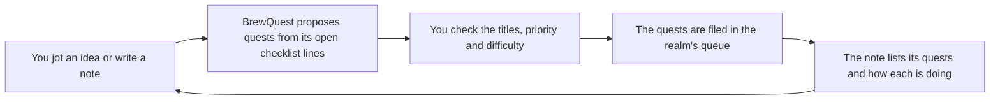

# Notes

Spec for **Notes 1**, the first slice of Rohan's Notes workspace epic. Mocha Mockup drew the screens on 7 November 2026 in `docs/notes.pen`. The same screens are in `docs/designs/notes-1/`, so the Designs tab shows them once this branch is merged. Rohan hasn't approved them yet. Notes 1 is built on `task/notes-workspace`; [What Notes 1 builds](#what-notes-1-builds) says where the build and the screens still differ.

## What the user can do

Open **Notes** (the last realm tab, ⌘7) and keep notes for the selected realm. Jot an idea in one line and it becomes a note in Inbox. Write longer notes in Markdown, file them in folders, tag them, and link them to each other with `[[Note title]]`. The inspector shows each note's links, the notes that link back to it, and the quests filed from it. **BrewQuest**, a small robot in the editor's corner, turns a note's open checklist lines into quests in the realm's queue. You check the proposal before anything is filed. A note you no longer need is archived, not deleted. Only an archived note can be deleted forever.



## Decisions

Settled before the design:

- **One Notes tab per realm**, after Mana & time, at `/notes`, opened with ⌘7. Notes belong to the selected realm only.
- **One Markdown file per note**, in `~/.queue-tea/notes/<realm key>/`, outside the realm's repository. An uncommitted file in the realm holds Start, and notes change all the time. The folder opens in Obsidian as a vault, as it is.
- **Three panes:** the note list, the editor and the inspector. The editor is a Markdown source editor (a text area), with a Read view beside it (see [The Read view](#the-read-view)).
- **Links are Obsidian's**: `[[Note title]]`, `[[Note title|shown text]]` and `[[Note title#heading]]`. Typing `[[` opens a picker. Renaming a note rewrites the links to it in the realm's other notes.
- **Autosave**, with a save line that says what is happening. If the file changes in another app while it's open, Queue-tea asks which version to keep.
- **Archive, not delete.** Delete forever is offered only for archived notes, behind a confirm dialog.
- **BrewQuest files nothing until you press File.** It proposes one parent quest named after the note, with one quest under it for each unticked `- [ ]` line not filed yet. A note with no such lines becomes one quest, made from its title and first paragraph.

Decided while drawing:

- **Sizes.** The list and the inspector are each 240 px wide, with 12 px between the panes. The editor takes the rest. The title is Marcellus 26 and the body is Nunito Sans 15 with 1.7 line spacing. The text column is at most 640 px wide, so lines stay under about 90 characters on a wide window.
- **Narrower windows** use the app's two existing widths. From 1,180 px the three panes sit side by side. From 900 to 1,179 px the inspector becomes a panel that floats over the editor's right edge, opened and closed with **Details** in the editor's head. Below 900 px the app's sidebar folds away and the tabs become a menu, as they do on every page, and the note list becomes a 300 px drawer opened with **Notes** in the editor's head (screen 6). Picking a note closes the drawer.
- **BrewQuest sits in the editor's foot**, a row of its own under the text area, aligned right. It never covers text, and it doesn't move. Its line counts what it can do ("3 checklist lines can be quests.").
- **One open line makes one quest, with no parent.** A parent holding a single quest adds nothing, so the parent comes only with two lines or more.
- **The parent row has no priority or difficulty.** The parent is made from its title alone, as Part of… → a new saga makes it today.
- **New lines join the note's own quest** when one has been filed already ("Filed under False steps in the March recordings.").
- **Filing goes one quest at a time,** through the same call New quest uses. Each quest is linked to the note as soon as it's in. If filing stops part way, the filed rows lock and Try again files only the rest (screen 4c). Nothing is ever filed twice.
- **Archived notes are read-only and leave the link graph.** The picker doesn't offer them, they count as no backlinks, and a link to one shows as not found. A note restored while another note has its title comes back as "Title 2".
- **Titles are unique** among the realm's notes that aren't archived, ignoring case, so a link always means one note.
- **Tags are one comma-separated field.** A leading `#` is dropped, and a space inside a tag becomes `-`, so Obsidian reads it as a tag.
- **The note's id is its file name**, without `.md`. New notes are named `n-` and eight hex digits. A note made in Obsidian keeps the name Obsidian gave it.
- **Queue-tea also writes `aliases`** with the title. Files are named by id, and Obsidian resolves `[[Title]]` through file names and aliases. Without aliases, links would break in Obsidian.
- **New note (⇧⌘N) works from every screen.** It opens Notes and starts an "Untitled" note in Inbox, with the title selected.

## The note file

```
~/.queue-tea/notes/
  gait-feedback/
    n-3f9a2b7e.md
    n-51c0e8d2.md
    Clinic visit 12 Nov.md        made in Obsidian
    n-3f9a2b7e.md.bak             last good copy, never listed
```

Queue-tea reads the `.md` files at the top of the realm's folder. It skips subfolders, hidden files (`.obsidian/` among them) and any name holding `/`, `\` or `..`. A file starts with front matter between two `---` lines, then the Markdown body.

```markdown
---
title: "False steps in the March recordings"
folder: "Research"
tags: ["research","step-detection"]
created: "2026-11-03T09:41:00.000Z"
updated: "2026-11-07T14:02:11.000Z"
archived: false
quests: [{"id":"t-8c41","item":null},{"id":"t-8c42","item":"Raise the heel strike threshold to 18 N and rerun sessions 1–6"}]
aliases: ["False steps in the March recordings"]
---
The step counter double-counts when a patient shuffles. Most false steps in the
March recordings come from heel lift under 18 N, which reads as a new strike.

See [[Sensor sampling rates]] for why 100 Hz misses the short lifts.

## Next
- [x] Mark the 41 false steps by hand in session 3
- [ ] Raise the heel strike threshold to 18 N and rerun sessions 1–6
- [ ] Log raw pressure at 200 Hz for one walk
```

| Field | Meaning |
| --- | --- |
| `title` | The note's name, up to 200 characters, without `[`, `]`, `|` or `#`. Without it, the title is the file name |
| `folder` | One level of free text, up to 60 characters. `Inbox` when missing |
| `tags` | Up to 20 tags of up to 40 characters, without `#`. A comma-separated string reads too |
| `created`, `updated` | ISO times. Without them, the file's time is used |
| `archived` | `true` or `false`. Missing reads as `false` |
| `quests` | The quests filed from this note: the quest's id, and the checklist line it came from, or `null` for the note's own quest (the parent, or the only one) |
| `aliases` | The title first, for Obsidian, then any other aliases the note had, which are kept. A rename drops the old title from it |

Queue-tea writes its values as JSON, which YAML reads too, so Obsidian shows them as properties. It also reads plain YAML values and lists, as Obsidian writes them. Every front-matter line it doesn't own is written back as it was read. A file with no front matter is a note too: its title is the file name and its folder is Inbox. Queue-tea adds the front matter the first time it saves that note.

A checklist line is a line starting with `- [ ] `, `* [ ] ` or `+ [ ] `. Its text is what's after the box, trimmed, up to 500 characters. A line counts as filed when its exact text is in `quests`. Editing a filed line's text makes it a new line.

## Screens

The screens are in `docs/notes.pen`, numbered as below, at the app's window size of 1,280 × 954 (screen 6 is 760 wide). The realm in them is Gait-feedback.

- **1 · A note open.**
  - **The list** has "Notes" and a count, with **New note** beside them. Under it are the capture line ("Jot an idea, then press Return…") and the search box ("Search titles, text and #tags"). The folders follow, Inbox first and the rest A–Z, each with a count and a fold arrow. Inside a folder, notes are newest edited first. A row shows the title and a line such as "Today 14:02 · #research", with the first tag. The open note's row is highlighted with the gold bar. **Archived (2)** sits at the foot.
  - **The editor's head** has the folder on the left and the save line on the right. Under them come the title and then the body. BrewQuest's card sits in the foot.
  - **The inspector** holds Folder (a field with the realm's folders as suggestions), Tags, Quests, Links and Backlinks. A link shows the note's title, or for a link that's not found, its title in grey with "No note with this title. Make it". **Make it** makes that note in the same folder and opens it. A backlink shows the line that links here. At the foot are the dates and **Archive note**.
- **2a · Loading.** After 150 ms, as on every page, the page shows the spinner, "Reading your notes…" and "Looking in ~/.queue-tea/notes/gait-feedback/". The notes come in one read, so there is no partly loaded state. When some files don't read, the rest show, and a line under the list names the files that don't: "Clinic visit.md couldn't be read, so it's left as it is."
- **2b · Empty realm.** The list keeps New note and the capture line, with "Ideas you jot here land in Inbox." under them. The page shows BrewQuest, "No notes in Gait-feedback yet", "Jot an idea on the left, or make a new note.", where the files live, and **New note** with ⇧⌘N.
- **2c · Couldn't read.** "Couldn't read Gait-feedback's notes" and "Queue-tea couldn't open ~/.queue-tea/notes/gait-feedback/. Check that the folder is there and that Queue-tea may read it, then try again.", with **Try again** and **Show in Finder**. The text comes from main's message, never from the error.
- **2d · Couldn't save.** The save line reads "Couldn't save. Your text is still here." in red, with **Try again**. The text stays in the editor. Queue-tea tries again on the next change and when you press Try again. While a note can't be saved, its list row says "Not saved", and its text stays in memory if you open another note.
- **2e · Changed on disk.** A banner under the head reads "This note changed outside Queue-tea" and "Its file was edited while it was open here. Pick which version to keep." It offers **Keep mine** (write yours over the file), **Load the file's version** (drop your unsaved edits) and **Save as new note** (keep both, yours as "Title 2"). The save line reads "Not saved: changed on disk", and nothing is written until you choose. If the file was deleted instead, the line reads "Its file was deleted while it was open here. Your text is still on screen.", and Keep mine writes it back.
- **3 · Link picker.** Typing `[[` opens a 320 px list under the line, moved left when it would leave the editor. It's headed "Notes to link" with what you typed and the number of matches. It offers up to 8 notes that aren't archived, leaving out the open one. Titles starting with the text come first, then titles with a word starting with it, then titles holding it anywhere. Ties go to the newest edited. Each row shows its folder, and the first row is highlighted. With no match it says "No note called “se” yet. Finish the name and close it with ]]."
- **4a · Review sheet** (600 px). "Turn False steps in the March recordings into quests", with BrewQuest and "BrewQuest drafted these from the note: one quest per unticked - [ ] line. Nothing is filed until you press File."
  - Each row has a box to include it, a title field and a caption ("From line 7", or "Parent quest, named after the note. It holds the quests below."). The rows under the parent also have Priority (Mid unless changed) and Difficulty (Medium unless changed). An unticked row is dimmed.
  - A line explains what isn't proposed ("“Mark the 41 false steps by hand in session 3” is checked off, so it isn't proposed."). Above the buttons is the total ("Files 3 quests in Gait-feedback: the parent, with 2 under it.").
  - The primary button counts too: **File 3 quests**. While filing it reads "Filing…", and the fields lock.
  - With nothing new to file, the sheet says "Everything in this note is in the queue already. Add a - [ ] line to the note to file more."
- **4b · Form error.** A cleared title shows a red field and "Quest title is required." under it. See Fields below.
- **4c · Filing failed part way.** A banner in the sheet: "2 of 3 quests are filed. “Log raw pressure at 200 Hz for one walk” isn't: Gait-feedback's queue couldn't be saved. Try again files only that one." The filed rows show "Filed · Waiting" and lock. The button reads **Try again**. When nothing was filed, the banner says so and the rows stay as they were.
- **4d · After filing.** The sheet closes, and a toast says "Filed 3 quests. They wait on the quest board." The inspector's Quests list shows the parent with "◆ Saga · 0/2 done" and the quests under it, each with its state (○ Waiting, Sealed, ▶ In progress, ✓ Done, or Not in the queue) and its priority and difficulty. The states update when the queue changes. Clicking a quest opens it on Quests. BrewQuest now says "Filed 3 quests. 1 line isn't a quest yet." Each quest's description starts "From the note "False steps in the March recordings" in Notes." The note's own quest adds the note's first paragraph.
- **5 · Archived and Delete forever.** **Archived (2)** turns the list into the archived notes. The header then reads "Archived 2", and the foot has **Back to notes**. Capture and New note are hidden. An archived note opens read-only, with "This note is archived. Restore it to edit it.", **Restore** and **Delete forever…**, and without BrewQuest. **Delete forever…** asks "Delete “Old sensor list” forever?" and says "Its file is removed and can't be brought back. Quests filed from it stay in the queue." When other notes link to it, a note in the dialog names them and says the links will show as not found. Focus starts on **Cancel**. **Delete note** removes the file and its last good copy. With no archived notes, the list says "No archived notes. An archived note waits here until you restore it or delete it."
- **6 · Narrow window.** Below 900 px the editor fills the page. Its head has **Notes** on the left, which opens the list as a drawer over the page with the page dimmed behind it, and **Details** on the right, which floats the inspector. Esc, ✕ or picking a note closes the drawer, and focus returns to **Notes**.

**Other states.** A search with no match says "Nothing has “sensor drift” in it. Try fewer words, or clear the search.", with **Clear search**. When notes exist but none is open, the editor says "Pick a note" and "Choose one from the list, or make a new one." The night sky uses the same theme tokens as every page, so it has no screen of its own.

## Keys and focus

| Key | Where | What it does |
| --- | --- | --- |
| ⌘7 | Anywhere | Opens Notes. The View menu and the palette's Go to list it |
| ⇧⌘N | Anywhere | A new "Untitled" note in Inbox, title selected (File › New note) |
| ⌘J | Notes | Puts the cursor in the capture line |
| ⌘F | Notes | Puts the cursor in search (Edit › Find). Esc in search clears it |
| ⌘E | A note | Turns Write into Read and back |
| ↩ / ⌘↩ | Capture line | Adds the idea to Inbox and stays in the line / adds it and opens it |
| ↑ ↓, ↩, ← → | Note list | Move between notes, open one (the cursor goes to the body), fold or unfold a folder |
| ↩, Esc | Title | Moves to the body / puts the saved title back |
| ↑ ↓, ↩ or Tab, Esc | Link picker | Move, insert `Title]]`, close and keep what was typed. Typing `]]` closes it too |
| Space, ⌘↩, Esc | Review sheet | Tick or untick a row, file, cancel |
| Esc | Drawer, floating inspector, dialogs | Closes them and puts focus back where it was |

⌘N stays New quest and ⌘Z stays the app's undo, except inside a text field. Tab in the body moves focus, as in any text area. Notes 1 doesn't indent with Tab.

**Focus order (wide window):** the tabs and toolbar → New note → capture → search → the note list (one stop, then arrows) → Archived → the save line's Try again or the banner's buttons, when shown → title → body → Turn into quests… → Folder → Tags → each quest → each link and Make it → each backlink → Archive note. In the sheet, focus starts on the first title field and the order runs row by row: box, title, priority, difficulty. Cancel and File come last.

## Fields and their checks

Each field checks itself when it loses focus and shows its error under it. An action checks every field again first.

| Field | Rule | Error |
| --- | --- | --- |
| Title * | Not empty | "Title is required." The save line says "Not saved: give the note a title first.", and the body keeps saving |
| | Up to 200 characters | "A note title can be 200 characters at most." |
| | No `[ ] \| #` | "A note title can't have [ ] \| or # in it, because links are made of them." |
| | Unique among notes that aren't archived, ignoring case | "A note called “Sensor sampling rates” already exists. Pick another title." |
| Folder | Up to 60 characters, and no `/` | "A folder name can be 60 characters at most." / "A folder is one level, so leave out /." Empty means Inbox |
| Tags | Each up to 40 characters, 20 at most | "A tag can be 40 characters at most." / "A note can have 20 tags at most." |
| Capture line | Not empty when Return is pressed | "Type an idea first." |
| Sheet: parent title * | Not empty, up to 200 | "Parent quest is required." / "A quest title can be 200 characters at most." |
| Sheet: quest title * | Not empty, up to 200 | "Quest title is required." / "A quest title can be 200 characters at most." |
| Sheet: the rows | At least one ticked, at most 50 | "Pick at least one quest to file." / "You can file 50 quests at most at once.", shown above the buttons |

A captured idea becomes a note's title when it fits as one: one line, 80 characters or fewer, without `[ ] | #`. Otherwise the title is its first 80 characters, cut at a word, without those characters and ending in "…", and the whole idea goes in the body. A taken title gets " 2", " 3" and so on.

## Behaviour

- **When it reads.** The page reads the realm's notes when it opens, when the realm changes, when the window regains focus and after each change it makes. It keeps the open note's text while it reads again.
- **Saving.** The editor saves 800 ms after typing stops, when it leaves the note, and when the window closes. The save line reads "Not saved yet" while it waits, then "Saving…" and then "Saved 14:02". One change runs at a time per realm. Every write goes to a temporary file that is then moved into place, and the last good copy is kept beside it as `<id>.md.bak`. Obsidian ignores that file and the list never shows it. A body over 1,000,000 characters isn't saved: "This note is too long to save. Split it into two notes."
- **Changed on disk.** The editor sends main the stamp of the file as it read it. If the file is different when a save comes, main writes nothing and returns the file as it is now, and the editor shows 2e. When the window regains focus, a note with no unsaved edits simply loads the newer file.
- **Renaming.** When a new title is saved, main rewrites `[[Old]]`, `[[Old|…]]` and `[[Old#…]]` in the realm's other notes, archived ones included. It skips this when another note still has the old title, because those links could mean that note. The save line then says "Saved 14:05 · links updated in 2 notes".
- **Search** ignores case. Every word you type must appear in the title, the body or a tag. A word starting with `#` matches tags only. Folders with no match hide.
- **Filing.** The window sends the note's id and the reviewed rows. Main checks them again. Then it files each quest with the call New quest uses (the parent first) and writes the quest into the note's `quests` straight away. It returns the notes and the realm's quests, so the quest board and the inspector update together.
- **Safety.** The window sends a realm key and a note id, never a path. Main checks the id (no `/`, `\` or `..`, not hidden, up to 120 characters), builds the path itself, and refuses to delete a note that isn't archived.
- **Motion.** Notes 1 has none of its own. BrewQuest is still, and under Reduce Motion or Calm mode the picker, sheet and drawer appear without a transition.
- **Screen readers.** The save line is a polite status and its errors are alerts. The picker is a list tied to the text area, so the highlighted note is announced. The sheet, the dialogs and the drawer are dialogs labelled by their titles.

## Architecture

The feature follows `docs/architecture.md` and the app's layers:

| Layer | Where | What |
| --- | --- | --- |
| Shared | `app/shared/notes.ts` | Types and limits, the id check, links, backlinks, renaming links, checklist lines, BrewQuest's proposal |
| Rules | `app/main/features/notes/domain/` | Reading and writing a note file: front matter in, the same front matter out |
| Engine API | `app/main/features/notes/api/` | `readNotes`, `showNotes` (Show in Finder, making the folder first), `createNote` (a taken title gets the next number), `saveNote` (with the stamp, renaming and how many notes it relinked, and a taken title refused), `archiveNote` (a restore onto a taken title is numbered), `deleteNote`, `fileNoteQuests` (skips lines the note already lists) |
| Window rules | `app/renderer/features/notes/domain/` | The list's folders and order, search, the picker's matches, the field checks, the capture title |
| Screens | `app/renderer/features/notes/presentation/` | The page, the list, the editor, the inspector, BrewQuest, the sheet and the dialogs |

Text the user reads goes in `app/renderer/l10n/en.ts` under `notebook`, and main's messages in `app/main/core/messages.ts`. The route `/notes` is in `app/renderer/config/routing/routes.ts`. The tab and ⌘7 are in `app/renderer/app/app.tsx`, the View menu in `app/main/core/app_menu.ts` and the palette's Go to in `app/renderer/features/palette/domain/palette.ts`. The values are `NOTE_AUTOSAVE_MS` (800) and `NOTE_PICKER_ROWS` (8), and the widths are `DETAIL_FLOATS_BELOW` (1,180) and `DETAIL_IS_PAGE_BELOW` (900), all in `app/renderer/core/constants/constants.ts`. ⇧⌘N from any screen goes through `app/renderer/features/notes/presentation/state_management/new_note.ts`, and File › New note sends the same key.

## Acceptance checks

1. Notes is the last realm tab, at `/notes`, and opens with ⌘7. The View menu and the palette list it. Its notes belong to the selected realm.
2. Return in the capture line makes a note in Inbox, and an empty line shows "Type an idea first.". A file with the note's front matter appears in `~/.queue-tea/notes/<realm key>/`, and nothing changes in the realm's folder.
3. A note opened, edited and left alone for 800 ms is saved. Reading the file back gives the same title, folder, tags and body, and front-matter lines Queue-tea doesn't own are kept.
4. A file with no front matter, as Obsidian makes them, lists with its file name as the title. The front matter is added when it's first saved.
5. Search finds a note by a word in its title, by a word in its body and by `#tag`. A search with no match shows its empty state.
6. Typing `[[` in the body opens the picker. ↓ and ↩ insert `Title]]`, and Esc closes it. Archived notes and the open note aren't offered.
7. The inspector lists a note's links, with a link that's not found marked, and its backlinks. **Make it** makes the missing note.
8. Renaming a note rewrites `[[Old]]`, `[[Old|x]]` and `[[Old#h]]` in the realm's other notes. It doesn't when another note has the old title.
9. When a note's file changes on disk while it has unsaved edits, the next save writes nothing and shows the banner. Each of its three choices does what it says.
10. A save that fails shows "Couldn't save. Your text is still here." and keeps the text. Try again saves it.
11. Archive hides the note from the list and the picker. Archived shows it read-only. Restore brings it back, as "Title 2" when the title is taken. Delete forever is offered only there, asks first, and removes the file and its `.bak`. Main refuses to delete a note that isn't archived.
12. Turn into quests… proposes a parent named after the note, with one quest per unticked line not yet filed. One line gives one quest, and no lines give the note itself as one quest. Nothing is written before File.
13. An empty title in the sheet shows "Quest title is required." under it on blur and on File, and files nothing.
14. File puts the quests in the realm's queue, in order, under the parent. Their descriptions name the note, and the note's `quests` lists them with their lines. Filing again proposes only lines not yet filed.
15. If filing fails part way, the filed rows lock, the banner says how many went in, and Try again files only the rest. No line is ever filed twice.
16. The inspector shows each filed quest's live state. Clicking one opens it on Quests.
17. From 900 to 1,179 px the inspector floats, opened by Details. Below 900 px the list is a drawer, opened by Notes and closed by Esc. Nothing scrolls sideways at 760 px.
18. BrewQuest's card never overlaps the text area at any window size.
19. Window-supplied ids never become a path outside the realm's notes folder.
20. `npm test`, `npm run typecheck` and `npm run e2e` pass in `app/`, along with the repository's checks.

## The Read view

Added after Notes 1, from the epic's first quest. **Write** and **Read** sit in the editor's head, and ⌘E turns one into the other. The choice stays as you move between notes. An archived note always reads.

- **What it draws:** headings, paragraphs, bold, italic, struck text, inline code, lists (nested and numbered), checklists, quotes, Obsidian callouts (`> [!warning] Title`), tables with their alignment, fenced code and rules.
- **Boxes:** ticking a box writes `[x]` into that line of the Markdown, or `[ ]` back, and saves as typing does. A box in an archived note can't be ticked. The boxes are counted in the order they're drawn, leaving out lines in fenced code, so the right line changes.
- **Links:** `[[Title]]` opens that note, and one with no note is drawn dashed. A web or email link opens in the browser through main, which refuses every other kind ("Queue-tea opens only web and email links from a note."). Local files follow the attachment rules below. A remote image remains a link that opens in the browser.
- **Safety:** marked 18.1.1 only cuts the text into tokens. Every token becomes an element in the window, so nothing in a note runs as HTML: `<b>` shows as `<b>`.

## Attachments

**Attach file…** sits between the title and body in a live note, in both Write and Read. Pick one or more files, drop them on the body, or paste a file from the clipboard. Ordinary text paste still writes text. The line beside the button says "Drop, paste or pick an image or PDF under 10 MB." An archived note can show and download files; restore it to attach another.

The window checks the file before reading it, and main checks its bytes before storing it. Accepted image formats are PNG, JPEG, GIF, WebP, BMP, ICO, AVIF and SVG, plus PDF. When a name has an extension, it must match the content. A pasted image or picked PDF without an extension uses its file type and detected content. Each file must be less than 10,485,760 bytes. Rejected types show "Only image or PDF files are accepted." Sizes at or above the limit show "File must be under 10 MB." Errors appear beside the attachment control.

Files live in `~/.queue-tea/notes/<realm key>/attachments/`. The name is the SHA-256 hash of the bytes, with the detected extension, so identical imports share one file. Main writes a temporary file, then publishes it without overwriting another writer's file. The body gets portable Markdown such as `` or `[Report](<attachments/hash.pdf>)`; the label keeps the picked name. Write inserts it at the text selection, or at the end when the note is in Read, and saves it through the note's usual conflict checks. These links work in an Obsidian vault too.

Read shows embedded images inline. A PDF has **Preview PDF**, which opens Electron's PDF viewer within the writing column, and **Close preview**. **Download** opens a save dialog for a copy. Existing files in the vault root or its `attachments` folder can be linked too, including other file types such as `[Table](table.csv)`, which offer Download. Such files also have the 10 MB read limit. Obsidian's `![[attachments/photo.png]]`, `[[attachments/report.pdf]]` and aliases after `|` are supported. Code spans and fenced code remain text.

Attaching and reading show a spinner and the file name. Images and PDF previews show "Loading preview…" until they load. A file that cannot be read is named and has **Try again**. Upload errors appear under the picker. When a batch stops, retry starts at the failed file; another drop or paste during an import joins the batch. A failed note save keeps the inserted Markdown and offers the existing save or conflict choices.

**Delete forever** removes only the note and its `.bak`. Every attachment stays, including files shared with another live or archived note, links in a backup, and files imported before a save failed. Remove unused files in the vault yourself when you no longer need them.

The controls wrap at narrower widths. The image fits the writing column and the PDF frame fills its width. Tab reaches Attach file, then the body and its file controls; Enter or Space activates buttons. Progress uses status announcements and errors use alerts. No new keyboard shortcut or motion is introduced.

### Attachment boundaries and design choice

Embedding file bytes as data URLs would keep the API smaller but repeat the bytes in the window and complicate PDF previews. Opening every file in another app would lose inline previews. A private `note-file:` protocol keeps previews inside Notes and lets main check every file request. The window's sandbox and context isolation stay enabled; Electron's plugin setting enables its built-in PDF viewer.

The shared contract is in `app/shared/note_attachments.ts`. The engine adds `attachNoteFile` (realm, live note id and file bytes), `readNoteFile` (realm and relative link, returning its path and detected kind) and `downloadNoteFile` (realm and link, returning false if the save dialog is cancelled). Replies use the existing engine error shape. Attachment import does not edit the note itself; its Markdown goes through `saveNote`, preserving the stamp and conflict flow.

Binary storage lives in `app/main/features/notes/data/note_files.ts`. Main accepts only relative file names at the vault root or one level under `attachments`, excluding Markdown, hidden names and traversal. Resolved paths must stay within the vault, so a symlink cannot redirect a preview or import outside it. The private protocol serves detected images and PDFs only, with the detected MIME type, no caching and a content security policy. Other files reach only the download API. The window's policy admits this protocol for images and frames, and disables object embeds. No absolute file path is accepted from the window.

Attachment checks cover validation, concurrent writers, reopening the API, shared-file retention and symlink escapes in the Notes API tests; drop, paste, retries and previews in component tests; and pick, paste, drop, rendered image pixels and the actual PDF viewer in `app/e2e/note_attachments.e2e.ts`. Run `npm test`, `npm run typecheck` and `npm run e2e` inside `app/`.

## Not in Notes 1

The calendar, meetings, ICS or Google sync, reminders, bookmarks, daily notes, the graph, the canvas, BrewQuest's animations and drag-to-note, AI note analysis, templates, version history and export. Notes in subfolders of the vault, inline `#tags` in the body, and indenting with Tab are left out too.

## Answered

Mocha Mockup's four open questions, as Notes 1 settles them:

1. **Titles are unique** among notes that aren't archived, ignoring case. The title field says so under it on blur, and main refuses a rename onto a taken title. A new note, a captured idea, Make it and Save as new note take the next number ("Plan 2"), and so does a note restored onto a taken title. Files made outside the app can still share a title; then a link means the newest, and renaming leaves those links alone.
2. **Queue-tea writes `aliases`**, with the title first, so Obsidian follows `[[Title]]` to the `n-…` files.
3. **A parent that's done or gone takes no more quests.** New lines go under a new parent named after the note (or make one quest, for one line). Main checks the record too: a `new` parent becomes the note's own quest while that quest is open.
4. **The file name is the id.** There is no `id` field.

## What Notes 1 builds

Everything in the screens and the acceptance checks above, with these small differences:

- **Filing that stops part way** shows main's message in the sheet's banner, locks the rows that went in ("Filed already. Try again files only the rest.") and turns the button into **Try again**. It doesn't count "2 of 3 quests are filed" in the banner itself.
- **The empty page** names the notes folder by its full path, not from `~`.
- **Loading** shows straight away, without the 150 ms wait.
