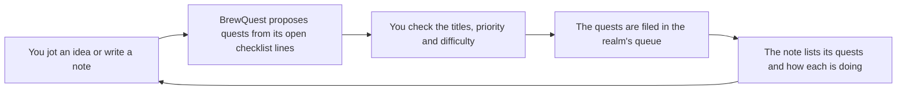

# Notes

For capture, search, recovery and a worked example from idea to saga, read the
[Notes user guide](notes-user-guide.md).

Spec for **Notes 1**, the first slice of Rohan's Notes workspace epic. Mocha Mockup drew the screens on 7 November 2026 in `docs/notes.pen`. The same screens are in `docs/designs/notes-1/`, so the Designs tab shows them once this branch is merged. Rohan hasn't approved them yet. Notes 1 is built on `task/notes-workspace`; [What Notes 1 builds](#what-notes-1-builds) says where the build and the screens still differ.

## What the user can do

Open **Notes** (the last realm tab, ⌘7) and keep notes for the selected realm. Jot an idea in one line and it becomes a note in Inbox. Write longer notes in Markdown, file them in folders, tag them, and link them to each other with `[[Note title]]`, or to one of the realm's quests. The inspector shows each note's links, the notes that link back to it, and the quests filed from it. **BrewQuest**, a small robot in the editor's corner, turns a note's open checklist lines into quests in the realm's queue. You check the proposal before anything is filed. A note you no longer need is archived, not deleted. Only an archived note can be deleted forever.



## Decisions

Settled before the design:

- **One Notes tab per realm**, after Mana & time, at `/notes`, opened with ⌘7. Notes belong to the selected realm only.
- **One Markdown file per note**, in `~/.queue-tea/notes/<realm key>/`, outside the realm's repository. An uncommitted file in the realm holds Start, and notes change all the time. The folder opens in Obsidian as a vault, as it is.
- **Three panes:** the note list, the editor and the inspector. The editor is a Markdown source editor (a text area), with a Read view beside it (see [The Read view](#the-read-view)).
- **Links are Obsidian's**: `[[Note title]]`, `[[Note title|shown text]]` and `[[Note title#heading]]`. Typing `[[` opens a picker. Renaming a note rewrites the links to it in the realm's other notes. A quest is linked by its id, as `[[quest:t-e84dd5ab|Write the parser]]`, so the link still works when the quest is renamed. The text after `|` is the quest's title when it was linked, with `[`, `]`, `|` and line breaks turned into spaces. Quest links aren't note links: they count as no backlinks, and renaming a note never rewrites them.
- **Autosave**, with a save line that says what is happening. If the file changes in another app while it's open, Queue-tea asks which version to keep.
- **Archive, not delete.** Delete forever is offered only for archived notes, behind a confirm dialog.
- **BrewQuest files nothing until you press File.** It proposes one parent quest named after the note, with one quest under it for each unticked `- [ ]` line not filed yet. A note with no such lines becomes one quest, made from its title and first paragraph.

Decided while drawing:

- **Sizes.** The list and the inspector are each 240 px wide, with 12 px between the panes. The editor takes the rest. The title is Marcellus 26 and the body is Nunito Sans 15 with 1.7 line spacing. The text column is at most 640 px wide, so lines stay under about 90 characters on a wide window.
- **Narrower windows** use the app's two existing widths. From 1,180 px the three panes sit side by side. From 900 to 1,179 px the inspector becomes a panel that floats over the editor's right edge, opened and closed with **Details** in the editor's head. Below 900 px the app's sidebar folds away and the tabs become a menu, as they do on every page, and the note list becomes a 300 px drawer opened with **Notes** in the editor's head (screen 6). Picking a note closes the drawer.
- **BrewQuest sits in the editor's foot**, a row of its own under the text area, aligned right. It never covers text, and it doesn't move. Its line counts what it can do ("3 checklist lines can be quests.").
- **One open line makes one quest, with no parent.** A parent holding a single quest adds nothing, so the parent comes only with two lines or more.
- **The parent row has no priority or difficulty.** The parent is made from its title alone, as Part of… → a new saga makes it today.
- **New lines join the note's own quest** when one has been filed already ("Filed under False steps in the March recordings.").
- **Filing goes one quest at a time,** through the same call New quest uses. Each quest is linked to the note as soon as it's in. If filing stops part way, the filed rows lock and Try again files only the rest (screen 4c). Nothing is ever filed twice.
- **Archived notes are read-only and leave the link graph.** The picker doesn't offer them, they count as no backlinks, and a link to one shows as not found. Their own quest links still show each quest's state. A note restored while another note has its title comes back as "Title 2".
- **Titles are unique** among the realm's notes that aren't archived, ignoring case, so a link always means one note.
- **Tags are one comma-separated field.** A leading `#` is dropped, and a space inside a tag becomes `-`, so Obsidian reads it as a tag.
- **The note's id is its file name**, without `.md`. New notes are named `n-` and eight hex digits. A note made in Obsidian keeps the name Obsidian gave it.
- **Queue-tea also writes `aliases`** with the title. Files are named by id, and Obsidian resolves `[[Title]]` through file names and aliases. Without aliases, links would break in Obsidian.
- **New note (⇧⌘N) works from every screen.** It opens Notes and starts an "Untitled" note in Inbox, with the title selected.

## The note file

```
~/.queue-tea/notes/
  gait-feedback/
    n-3f9a2b7e.md
    n-51c0e8d2.md
    Clinic visit 12 Nov.md        made in Obsidian
    .history/
      n-3f9a2b7e/                 saved versions, never listed
```

Queue-tea reads the `.md` files at the top of the realm's folder. It skips subfolders, hidden files (`.obsidian/` among them) and any name holding `/`, `\` or `..`. A file starts with front matter between two `---` lines, then the Markdown body.

```markdown
---
title: "False steps in the March recordings"
folder: "Research"
tags: ["research","step-detection"]
created: "2026-11-03T09:41:00.000Z"
updated: "2026-11-07T14:02:11.000Z"
archived: false
quests: [{"id":"t-8c41","item":null},{"id":"t-8c42","item":"Raise the heel strike threshold to 18 N and rerun sessions 1–6"}]
aliases: ["False steps in the March recordings"]
---
The step counter double-counts when a patient shuffles. Most false steps in the
March recordings come from heel lift under 18 N, which reads as a new strike.

See [[Sensor sampling rates]] for why 100 Hz misses the short lifts.

## Next
- [x] Mark the 41 false steps by hand in session 3
- [ ] Raise the heel strike threshold to 18 N and rerun sessions 1–6
- [ ] Log raw pressure at 200 Hz for one walk
```

| Field | Meaning |
| --- | --- |
| `title` | The note's name, up to 200 characters, without `[`, `]`, `|` or `#`. Without it, the title is the file name |
| `folder` | One level of free text, up to 60 characters. `Inbox` when missing |
| `type` | `idea`, `feature`, `bug`, `meeting`, `research`, `decision` or `daily`, written only when set. Any other value, such as `type: book` from Obsidian, is kept as it was until a type is picked here |
| `pinned` | `true` when the note is pinned, and written only then |
| `tags` | Up to 20 tags of up to 40 characters, without `#`. A comma-separated string reads too |
| `created`, `updated` | ISO times. Without them, the file's time is used |
| `archived` | `true` or `false`. Missing reads as `false` |
| `quests` | The quests filed from this note: the quest's id, and the checklist line it came from, or `null` for the note's own quest (the parent, or the only one) |
| `aliases` | The title first, for Obsidian, then any other aliases the note had, which are kept. A rename drops the old title from it |

Queue-tea writes its values as JSON, which YAML reads too, so Obsidian shows them as properties. It also reads plain YAML values and lists, as Obsidian writes them. Every front-matter line it doesn't own is written back as it was read. A file with no front matter is a note too: its title is the file name and its folder is Inbox. Queue-tea adds the front matter the first time it saves that note.

A checklist line is a line starting with `- [ ] `, `* [ ] ` or `+ [ ] `. Its text is what's after the box, trimmed, up to 500 characters. A line counts as filed when its exact text is in `quests`. Editing a filed line's text makes it a new line.

## Screens

The screens are in `docs/notes.pen`, numbered as below, at the app's window size of 1,280 × 954 (screen 6 is 760 wide). The realm in them is Gait-feedback.

- **1 · A note open.**
  - **The list** has "Notes" and a count, with **New note** beside them. Under it are the capture line ("Jot an idea, then press Return…") and the search box ("Search titles, text and #tags"). The folders follow, Inbox first and the rest A–Z, each with a count and a fold arrow. Inside a folder, notes are newest edited first. A row shows the title and a line such as "Today 14:02 · #research", with the first tag. The open note's row is highlighted with the gold bar. **Archived (2)** sits at the foot.
  - **The editor's head** has the folder on the left and the save line on the right. Under them come the title and then the body. BrewQuest's card sits in the foot.
  - **The inspector** holds Folder (a field with the realm's folders as suggestions), Tags, Quests, Links and Backlinks. A link shows the note's title, or for a link that's not found, its title in grey with "No note with this title. Make it". **Make it** makes that note in the same folder and opens it. Quest links follow the note links, each shown like a filed quest in the Quests list (title, state, priority and difficulty), and the Links count includes them. A backlink shows the line that links here. At the foot are the dates and **Archive note**.
- **2a · Loading.** After 150 ms, as on every page, the page shows the spinner, "Reading your notes…" and "Looking in ~/.queue-tea/notes/gait-feedback/". The notes come in one read, so there is no partly loaded state. When some files don't read, the rest show, and a line under the list names the files that don't: "Clinic visit.md couldn't be read, so it's left as it is."
- **2b · Empty realm.** The list keeps New note and the capture line, with "Ideas you jot here land in Inbox." under them. The page shows BrewQuest, "No notes in Gait-feedback yet", "Jot an idea on the left, or make a new note.", where the files live, and **New note** with ⇧⌘N.
- **2c · Couldn't read.** "Couldn't read Gait-feedback's notes" and "Queue-tea couldn't open ~/.queue-tea/notes/gait-feedback/. Check that the folder is there and that Queue-tea may read it, then try again.", with **Try again** and **Show in Finder**. The text comes from main's message, never from the error.
- **2d · Couldn't save.** The save line reads "Couldn't save. Your text is still here." in red, with **Try again**. The text stays in the editor. Queue-tea tries again on the next change and when you press Try again. While a note can't be saved, its list row says "Not saved", and its text stays in memory if you open another note.
- **2e · Changed on disk.** A banner under the head reads "This note changed outside Queue-tea" and "Its file was edited while it was open here. Pick which version to keep." It offers **Keep mine** (write yours over the file), **Load the file's version** (drop your unsaved edits) and **Save as new note** (keep both, yours as "Title 2"). The save line reads "Not saved: changed on disk", and nothing is written until you choose. If the file was deleted instead, the line reads "Its file was deleted while it was open here. Your text is still on screen.", and Keep mine writes it back.
- **3 · Link picker.** Typing `[[` opens a 320 px list under the line, moved left when it would leave the editor. It's headed "Link to “par”" ("Link to a note or a quest" before you type) and the number of matches, such as "2 notes · 3 quests". It offers up to 8 rows: notes that aren't archived, leaving out the open one, then the realm's quests in play (in progress, waiting or sealed). Titles starting with the text come first, then titles with a word starting with it, then titles holding it anywhere. Ties go to the newest edited note, and among quests to in progress, then waiting, then sealed. Up to 3 rows are kept for quests when that many match and notes take the rest, but each side fills what the other leaves: with enough of both, a bare `[[` shows 5 notes and 3 quests. A hairline separates the quests. A note row shows its folder, a quest row its state ("▶ In progress", "○ Waiting" or "Sealed"), and the first row is highlighted. Done and gone quests aren't offered, because Quests can't open a done quest, and neither is a note titled like a quest link (`quest:t-…`). With no match it says "No note or quest called “se” yet. Finish the name and close it with ]]."
- **4a · Review sheet** (600 px). "Turn False steps in the March recordings into quests", with BrewQuest and "BrewQuest drafted these from the note: one quest per unticked - [ ] line. Nothing is filed until you press File."
  - Each row has a box to include it, a title field and a caption ("From line 7", or "Parent quest, named after the note. It holds the quests below."). The rows under the parent also have Priority (Mid unless changed) and Difficulty (Medium unless changed). An unticked row is dimmed.
  - A line explains what isn't proposed ("“Mark the 41 false steps by hand in session 3” is checked off, so it isn't proposed."). Above the buttons is the total ("Files 3 quests in Gait-feedback: the parent, with 2 under it.").
  - The primary button counts too: **File 3 quests**. While filing it reads "Filing…", and the fields lock.
  - With nothing new to file, the sheet says "Everything in this note is in the queue already. Add a - [ ] line to the note to file more."
- **4b · Form error.** A cleared title shows a red field and "Quest title is required." under it. See Fields below.
- **4c · Filing failed part way.** A banner in the sheet: "2 of 3 quests are filed. “Log raw pressure at 200 Hz for one walk” isn't: Gait-feedback's queue couldn't be saved. Try again files only that one." The filed rows show "Filed · Waiting" and lock. The button reads **Try again**. When nothing was filed, the banner says so and the rows stay as they were.
- **4d · After filing.** The sheet closes, and a toast says "Filed 3 quests. They wait on the quest board." The inspector's Quests list shows the parent with "◆ Saga · 0/2 done" and the quests under it, each with its state (○ Waiting, Sealed, ▶ In progress, ✓ Done, or Not in the queue) and its priority and difficulty. The states update when the queue changes. Clicking a quest opens it on Quests. A done quest isn't a button, since Quests can't open it. BrewQuest now says "Filed 3 quests. 1 line isn't a quest yet." Each quest's description starts "From the note "False steps in the March recordings" in Notes." The note's own quest adds the note's first paragraph.
- **5 · Archived and Delete forever.** **Archived (2)** turns the list into the archived notes. The header then reads "Archived 2", and the foot has **Back to notes**. Capture and New note are hidden. An archived note opens read-only, with "This note is archived. Restore it to edit it.", **Restore** and **Delete forever…**, and without BrewQuest. **Delete forever…** asks "Delete “Old sensor list” forever?" and says "Its file and saved history are removed and can't be brought back. Quests filed from it stay in the queue." When other notes link to it, a note in the dialog names them and says the links will show as not found. Focus starts on **Cancel**. **Delete note** removes the file and its saved history. With no archived notes, the list says "No archived notes. An archived note waits here until you restore it or delete it."
- **6 · Narrow window.** Below 900 px the editor fills the page. Its head has **Notes** on the left, which opens the list as a drawer over the page with the page dimmed behind it, and **Details** on the right, which floats the inspector. Esc, ✕ or picking a note closes the drawer, and focus returns to **Notes**.

**Other states.** A search with no match says "Nothing has “sensor drift” in it. Try fewer words, or clear the search.", with **Clear search**. When notes exist but none is open, the editor says "Pick a note" and "Choose one from the list, or make a new one." The night sky uses the same theme tokens as every page, so it has no screen of its own.

## Keys and focus

| Key | Where | What it does |
| --- | --- | --- |
| ⌘7 | Anywhere | Opens Notes. The View menu and the palette's Go to list it |
| ⌘K | Anywhere | Finds notes by title, text and tags; offers New note and Jot into Inbox |
| ⇧⌘N | Anywhere | A new "Untitled" note in Inbox, title selected (File › New note) |
| ⌘J | Notes | Puts the cursor in the capture line |
| ⌘F | Notes | Puts the cursor in search (Edit › Find). Esc in search clears it |
| ⌘E | A note | Turns Write into Read and back |
| ↩ / ⌘↩ | Capture line | Adds the idea to Inbox and stays in the line / adds it and opens it |
| ↑ ↓, ↩, ← | Note list | Move between notes, open one (the cursor goes to the body), fold its folder. Use the folder heading to reopen it |
| ↩, Esc | Title | Moves to the body / puts the saved title back |
| ↑ ↓, ↩ or Tab, Esc | Link picker | Move, insert `Title]]` (for a quest, `quest:<id>\|Title]]`), close and keep what was typed. Typing `]]` closes it too |
| Space, ⌘↩, Esc | Review sheet | Tick or untick a row, file, cancel |
| Esc | Drawer, floating inspector, dialogs | Closes them and puts focus back where it was |

⌘N stays New quest and ⌘Z stays the app's undo, except inside a text field. Tab in the body moves focus, as in any text area. Notes 1 doesn't indent with Tab.

**Focus order (wide window):** the tabs and toolbar → New note → capture → search → the note list (one stop, then arrows) → Archived → the save line's Try again or the banner's buttons, when shown → title → body → Turn into quests… → Folder → Tags → each quest → each link and Make it → each backlink → Archive note. In the sheet, focus starts on the first title field and the order runs row by row: box, title, priority, difficulty. Cancel and File come last.

## Fields and their checks

Each field checks itself when it loses focus and shows its error under it. An action checks every field again first.

| Field | Rule | Error |
| --- | --- | --- |
| Title * | Not empty | "Title is required." The save line says "Not saved: give the note a title first.", and the body keeps saving |
| | Up to 200 characters | "A note title can be 200 characters at most." |
| | No `[ ] \| #` | "A note title can't have [ ] \| or # in it, because links are made of them." |
| | Unique among notes that aren't archived, ignoring case | "A note called “Sensor sampling rates” already exists. Pick another title." |
| Folder | Up to 60 characters, and no `/` | "A folder name can be 60 characters at most." / "A folder is one level, so leave out /." Empty means Inbox |
| Tags | Each up to 40 characters, 20 at most | "A tag can be 40 characters at most." / "A note can have 20 tags at most." |
| Capture line | Not empty when Return is pressed | "Type an idea first." |
| Sheet: parent title * | Not empty, up to 200 | "Parent quest is required." / "A quest title can be 200 characters at most." |
| Sheet: quest title * | Not empty, up to 200 | "Quest title is required." / "A quest title can be 200 characters at most." |
| Sheet: the rows | At least one ticked, at most 50 | "Pick at least one quest to file." / "You can file 50 quests at most at once.", shown above the buttons |

A captured idea uses its first line as the title, with `[ ] | #` replaced by spaces and repeated spaces collapsed. A title longer than 80 characters is cut at a word when possible and ends in "…". An empty cleaned title becomes **Untitled**. The whole trimmed idea goes in the body when it differs from the title. A taken title gets " 2", " 3" and so on.

## Behaviour

- **When it reads.** The page reads the realm's notes when it opens, when the realm changes, when the window regains focus and after each change it makes. It keeps the open note's text while it reads again.
- **Saving.** The editor saves 800 ms after typing stops, when it leaves the note, and when the window closes. The save line reads "Not saved yet" while it waits, then "Saving…" and then "Saved 14:02". One change runs at a time. Every write goes to a temporary file that is then moved into place, with a snapshot in `.history/<id>/` (see [Version history](#version-history)). A body over 1,000,000 characters isn't saved: "This note is too long to save. Split it into two notes."
- **Changed on disk.** The editor sends main the stamp of the file as it read it. If the file is different when a save comes, main writes nothing and returns the file as it is now, and the editor shows 2e. When the window regains focus, a note with no unsaved edits simply loads the newer file.
- **Renaming.** When a new title is saved, main rewrites `[[Old]]`, `[[Old|…]]` and `[[Old#…]]` in the realm's other notes, archived ones included. It skips this when another note still has the old title, because those links could mean that note. The save line then says "Saved 14:05 · links updated in 2 notes".
- **Search** ignores case. Every word you type must appear in the title, the body or a tag. A word starting with `#` matches tags only. Folders with no match hide.
- **Filing.** The window sends the note's id and the reviewed rows. Main checks them again. Then it files each quest with the call New quest uses (the parent first) and writes the quest into the note's `quests` straight away. It returns the notes and the realm's quests, so the quest board and the inspector update together.
- **Safety.** The window sends a realm key and a note id, never a path. Main checks the id (no `/`, `\` or `..`, not hidden, up to 120 characters), builds the path itself, and refuses to delete a note that isn't archived.
- **Motion.** Notes 1 has none of its own. BrewQuest is still, and under Reduce Motion or Calm mode the picker, sheet and drawer appear without a transition.
- **Screen readers.** The save line is a polite status and its errors are alerts. The picker is a list tied to the text area, so the highlighted note or quest is announced. A quest is read with its state: "Write the parser, quest, in progress". The sheet, the dialogs and the drawer are dialogs labelled by their titles.

## Architecture

The feature follows `docs/architecture.md` and the app's layers:

| Layer | Where | What |
| --- | --- | --- |
| Shared | `app/shared/notes.ts` | Types and limits, the id check, links and quest links, backlinks, renaming links, checklist lines, BrewQuest's proposal |
| Rules | `app/main/features/notes/domain/` | Reading and writing a note file: front matter in, the same front matter out |
| Engine API | `app/main/features/notes/api/` | `readNotes`, `showNotes` (Show in Finder, making the folder first), `createNote` (a taken title gets the next number), `saveNote` (with the stamp, renaming and how many notes it relinked, and a taken title refused), `archiveNote` (a restore onto a taken title is numbered), `deleteNote`, `fileNoteQuests` (skips lines the note already lists), `exportNotes` (a new backup folder, never written over another) and `restoreNotes` (adds what's missing, replaces nothing) |
| Window rules | `app/renderer/features/notes/domain/` | The list's folders and order, search, the picker's notes and quests, the field checks, the capture title |
| Screens | `app/renderer/features/notes/presentation/` | The page, the list, the editor, the inspector, BrewQuest, the sheet and the dialogs |
| Graph rules | `app/renderer/features/notes/domain/note_graph.ts`, `note_graph_layout.ts` | The graph from the notes and quests, the steps around a note, the filters, the layout, hit testing and the arrow keys |
| Graph controller | `app/renderer/features/notes/presentation/state_management/graph_layout.ts`, `note_graph.worker.ts` | Runs the layout in a worker, passes on its progress and turns a failure into the failed state |
| Graph screen | `app/renderer/features/notes/presentation/widgets/note_graph_view.tsx`, `note_graph_draw.ts` | The controls, the canvas and its drawing, pan and zoom, clicks and keys |

Text the user reads goes in `app/renderer/l10n/en.ts` under `notebook` and `palette`, with attaching and previewing files under `files`, and main's messages in `app/main/core/messages.ts`. The route `/notes` is in `app/renderer/config/routing/routes.ts`. The tab and ⌘7 are in `app/renderer/app/app.tsx`, the View menu in `app/main/core/app_menu.ts` and the palette's Go to in `app/renderer/features/palette/domain/palette.ts`. The values are `NOTE_AUTOSAVE_MS` (800), `NOTE_PICKER_ROWS` (8), `NOTE_PICKER_QUEST_ROWS` (3), `PALETTE_NOTE_ROWS` (5) and `PALETTE_SNIPPET` (60); for the graph's layout `GRAPH_LINK_DISTANCE` (60), `GRAPH_CHARGE` (-120), `GRAPH_GRAVITY` (0.04), `GRAPH_TICKS` (150), `GRAPH_THETA` (1.2), `GRAPH_WARM_ALPHA` (0.1) and `GRAPH_PROGRESS_TICKS` (20), and for its screen `GRAPH_SPINNER_MS` (150), `GRAPH_LABEL_ZOOM` (1.5), `GRAPH_HIT_PX` (10), `GRAPH_LABEL_CHARS` (40), `GRAPH_ZOOM_MIN` (0.05), `GRAPH_ZOOM_MAX` (4), `GRAPH_DRAG_PX` (3) and `GRAPH_FIT_PX` (40); and the widths are `DETAIL_FLOATS_BELOW` (1,180) and `DETAIL_IS_PAGE_BELOW` (900), all in `app/renderer/core/constants/constants.ts`. ⇧⌘N and the palette's new, open and jot requests go through `app/renderer/features/notes/presentation/state_management/notes_asks.ts`. File › New note sends the same key. A jot that stays on another screen is saved by `note_flows.ts` in that same folder.

## Acceptance checks

1. Notes is the last realm tab, at `/notes`, and opens with ⌘7. The View menu and the palette list it. Its notes belong to the selected realm.
2. Return in the capture line makes a note in Inbox, and an empty line shows "Type an idea first.". A file with the note's front matter appears in `~/.queue-tea/notes/<realm key>/`, and nothing changes in the realm's folder.
3. A note opened, edited and left alone for 800 ms is saved. Reading the file back gives the same title, folder, tags and body, and front-matter lines Queue-tea doesn't own are kept.
4. A file with no front matter, as Obsidian makes them, lists with its file name as the title. The front matter is added when it's first saved.
5. Search finds a note by a word in its title, by a word in its body and by `#tag`. A search with no match shows its empty state.
6. Typing `[[` in the body opens the picker, with notes and then quests in play. ↓ and ↩ insert `Title]]`, or `quest:<id>|Title]]` for a quest, and Esc closes it. Archived notes, the open note and done or gone quests aren't offered.
7. The inspector lists a note's links, with a link that's not found marked, then its quest links with each quest's live state, and its backlinks. **Make it** makes the missing note. A quest link counts as no backlink.
8. Renaming a note rewrites `[[Old]]`, `[[Old|x]]` and `[[Old#h]]` in the realm's other notes. It doesn't when another note has the old title.
9. When a note's file changes on disk while it has unsaved edits, the next save writes nothing and shows the banner. Each of its three choices does what it says.
10. A save that fails shows "Couldn't save. Your text is still here." and keeps the text. Try again saves it.
11. Archive hides the note from the list and the picker. Archived shows it read-only. Restore brings it back, as "Title 2" when the title is taken. Delete forever is offered only there, asks first, and removes the file, its saved history and any legacy `.bak`. Main refuses to delete a note that isn't archived.
12. Turn into quests… proposes a parent named after the note, with one quest per unticked line not yet filed. One line gives one quest, and no lines give the note itself as one quest. Nothing is written before File.
13. An empty title in the sheet shows "Quest title is required." under it on blur and on File, and files nothing.
14. File puts the quests in the realm's queue, in order, under the parent. Their descriptions name the note, and the note's `quests` lists them with their lines. Filing again proposes only lines not yet filed.
15. If filing fails part way, the filed rows lock, the banner says how many went in, and Try again files only the rest. No line is ever filed twice.
16. The inspector shows each filed quest's live state. Clicking one in play opens it on Quests.
17. From 900 to 1,179 px the inspector floats, opened by Details. Below 900 px the list is a drawer, opened by Notes and closed by Esc. Nothing scrolls sideways at 760 px.
18. BrewQuest's card never overlaps the text area at any window size.
19. Window-supplied ids never become a path outside the realm's notes folder.
20. `npm test`, `npm run typecheck` and `npm run e2e` pass in `app/`, along with the repository's checks.
21. ⌘K finds the selected realm's live notes by title and text and opens the chosen note. New note and Jot work from another screen. Reading or failed notes leave other commands usable, and a failed jot can be retried with the same words.

## The Read view

Added after Notes 1, from the epic's first quest. **Write** and **Read** sit in the editor's head, and ⌘E turns one into the other. The choice stays as you move between notes. An archived note always reads.

- **What it draws:** headings, paragraphs, bold, italic, struck text, inline code, lists (nested and numbered), checklists, quotes, Obsidian callouts (`> [!warning] Title`), tables with their alignment, fenced code and rules.
- **Boxes:** ticking a box writes `[x]` into that line of the Markdown, or `[ ]` back, and saves as typing does. A box in an archived note can't be ticked. The boxes are counted in the order they're drawn, leaving out lines in fenced code, so the right line changes.
- **Links:** `[[Title]]` opens that note, and one with no note is drawn dashed. A quest link shows the quest's live title with its state. Markdown marks in the written title stay part of the link; quest syntax inside code stays code. A quest in play is a button that opens it in Quests, read as "Open Write the parser in Quests, in progress". A done quest shows its title and "✓ Done" and isn't a button. A quest no longer in the queue shows the written text, grey and dashed like a missing note, with "Not in the queue". A web or email link opens in the browser through main, which refuses every other kind ("Queue-tea opens only web and email links from a note."). A web link alone on a line is a bookmark card (see [Bookmarks](#bookmarks)). Local files follow the attachment rules below. A remote image remains a link that opens in the browser.
- **Safety:** marked 18.1.1 only cuts the text into tokens. Every token becomes an element in the window, so nothing in a note runs as HTML: `<b>` shows as `<b>`.

## Version history

**History**, beside the save line, opens a 600 px sheet for the open note, including an archived note. Pending edits save before it opens; a failed save leaves the editor and its text in place. The sheet lists saved times newest first, with a read-only preview of the selected version's title, folder, tags and Markdown source. Text in a snapshot never runs as HTML. The current version is marked and cannot be restored over itself.

Choose an earlier save, then **Restore this version** (or ⌘↩). This restores its title, folder, tags and text as a new save. The replaced note remains in History. Current quest links, archive status, type, pin, creation time and other front-matter properties stay with the note, so restoring text cannot make already filed checklist items file again. A live note restored onto a taken title gets the next number, such as "Plan 2". A title change updates backlinks as a normal rename does.

If the file changes or disappears after History opens, restore writes nothing. The sheet asks you to close History, check the current note, then open History again. Failed reads offer **Try again** where the list or preview was. A failed restore keeps the preview and lets you retry. While restoring, a spinner says "Restoring this version…" and the sheet's controls lock. Success closes the sheet and says "Version restored. The replaced note is in History."

Tab and Shift-Tab stay inside the sheet. Esc and **Close history** close it and return focus to **History**, except while a restore is running. The saved times and preview scroll separately. Below 600 px they stack.

Every write keeps a version, including creation, archive changes, quest links and rewritten backlinks. Before an imported or externally edited note is overwritten, its exact file is kept too. A note made outside Queue-tea has no history until its first save. An existing `.bak` joins that initial history and is removed after the live file saves successfully. Snapshots are Markdown files in `~/.queue-tea/notes/<realm key>/.history/<note id>/`, hidden from Notes and Obsidian's normal file list. Each file name holds a save time and a SHA-1 content stamp; a missing or damaged snapshot is refused when opened or restored.

The limit is 100 versions per note: 50 recent saves, then up to 24 older versions from distinct hours, then up to 26 from distinct days. Extra versions are pruned after a successful write. The hour and day buckets use UTC. This preserves older recovery points through bursts of 800 ms autosaves. A failed replacement can leave a recoverable snapshot of the attempted save; the live file stays intact. **Delete forever…** removes the note's entire history too.

The shared contract adds `NoteVersion` and `readNoteHistory`, `readNoteVersion`, `restoreNoteVersion` to the engine API. Reads and restores run in the same queue as saves, so the app cannot prune a version midway through reading it. Restore takes the current file stamp and returns the same saved-or-changed result as `saveNote`. Retention rules live in `app/main/features/notes/domain/note_history.ts`, the sheet in `app/renderer/features/notes/presentation/widgets/note_history.tsx`, and the policy constants in `app/shared/notes.ts`.

Checks for this follow-up:

1. Create and edit a note, open History, preview the earlier save and restore it. The file on disk matches the restored text, and the replaced text can still be previewed.
2. Save repeatedly across hours and days, then in a rapid burst. At most 100 versions remain; old hourly and daily recovery points survive the burst.
3. Restore after filing quests or archiving. Quest links and archive status stay current. A stale restore changes no file.
4. Read history after reopening the API. Invalid realm, note or version ids cannot escape the notes folder. Damaged versions and failed writes show errors without corrupting the live note.
5. Check loading, empty, failed, restoring and success states, keyboard focus, and the sheet at 760 px. Delete forever removes the history.

## Templates, types and pinned notes

Added after Notes 1, from the epic's "templates and pinned notes" quest.

- **Types:** a note can be an Idea, Feature, Bug, Meeting, Research, Decision or Daily note, or none. The type is its own setting, apart from the folder, so a Bug note can sit in any folder. The inspector's **Type** list changes it and never touches the text. The editor's head shows it after the folder.
- **Templates:** a note with no text and no type shows **Start from a template** under the editor, with a button for each type. A button sets the type, fills in the template's headings and puts the cursor under the first. A Daily note still called Untitled takes today's date as its title ("2026-11-07"), numbered when that's taken. Once the note has text, the row goes. The templates' text is in `app/renderer/l10n/en.ts`.

| Type | The template's headings |
| --- | --- |
| Idea | The idea, Why it matters, Next steps (a checklist) |
| Feature | Goal, What it does (a checklist), Open questions |
| Bug | Steps to reproduce, Expected, Actual, Fix (a checklist) |
| Meeting | Attendees, Notes, Actions (a checklist) |
| Research | Question, Sources, Findings, Still open |
| Decision | Context, Options, Decision, Consequences |
| Daily | Today (a checklist), Notes, Done |

- **Pinned notes:** **Pin note** at the foot of the inspector saves at once and puts the note in a **Pinned** group at the top of the list, where its row also names its folder. A pinned note shows only there, not in its folder as well. **Unpin note** puts it back. An archived note keeps its pin for when it's restored, and the archived list shows it in its folder.
- **Renaming a folder:** every folder but Inbox has **Rename**, which shows when you point at the folder or tab to it, including in Archived. When all its live notes are pinned, open one and use **Rename folder** under Folder in the inspector. The dialog asks for the new name, required and checked as the Folder field is, with any error under it. Every note in the folder moves, archived ones too, and a name already in use puts the two folders together. If the open note is in the folder, it saves first; if it can't, nothing is renamed and the dialog says so. A failure part way leaves the notes already moved in the new folder; pressing **Rename folder** again moves the rest. Renaming doesn't change a note's edited time.
- **Moving a note keeps its links:** a link names a note by its title, and every file sits at the top of the realm's folder whatever its folder, so changing a note's Folder field or renaming its folder never changes a link.

## Daily notes and the journal

Added from the epic's "daily notes and a journal" quest.

- **A day's note is the live note titled with its date**, `2026-11-17`, as Obsidian's daily notes plugin names them. That makes `[[2026-11-17]]` a link to that day, here and in Obsidian. A title that isn't a real date, such as `2026-02-30`, is an ordinary note.
- **Today**, in the list's head, opens today's note, using this Mac's local date. When there isn't one yet, it makes it in the **Journal** folder, typed Daily, from the daily template, and puts the cursor in its text. Today is hidden in Archived.
- **Journal (n)** at the list's foot counts the days and turns the list into the journal: the days newest first, a group per month ("Nov 2026"), each row naming its weekday ("Tue 17 Nov"). Search works on the days as it does on notes. **Back to notes** returns. A day keeps showing in its folder too, since the journal goes by title, not by folder.
- **Day \*** in the journal picks any date, today by default, and **Open day** opens or makes that day, staying in the journal. An empty field says "Day is required." and a date that isn't one says "Enter a day as a date, like 2026-11-17.", under the field, on blur and on Open day.
- **The daily template is a note.** New days start from the live note titled **Daily template** when it has text, with `{{date}}` and `{{title}}` turned into the day. Without one, they start from the built-in Daily headings above. **Edit the daily template**, under the day field, opens that note, or makes it in Journal with the built-in headings for you to change. Picking Daily under **Start from a template** uses it too. Keeping the template as a note means it saves, versions and syncs to Obsidian like any other, with no setting of its own.

The rules are `isDay`, `dayError`, `dailyBodyOf` and `journalOf` in `app/renderer/features/notes/domain/notes_view.ts`. The page uses `createNote` as it is, with the type and body filled in, so main is unchanged. `JOURNAL` and `DAILY_TEMPLATE` are in `app/shared/notes.ts`.

## Notes in the command palette

Open ⌘K from any screen and type words from a note. The palette reads only the selected realm's notes, when it opens and when the engine announces a change. Search follows Notes search: every word must appear in the title, text or tags, ignoring case; `#word` matches tags only. Archived notes stay out. Title matches rank above text matches, with the newest edited note first among equal matches. Up to five notes appear. A text match shows its matching line, cut to 60 characters with ellipses when needed.

↑ and ↓ choose a result. Return or ⌘Return opens that note on **Notes**, including when another note is already open. Type **New note** to make an **Untitled** note in Inbox with its title selected. Its ⇧⌘N shortcut works from every screen too. These actions use the selected realm; without one, the palette still offers navigation.

With words typed, the **Create** section offers both **New quest** and **Jot into Inbox**. Return on Jot saves the idea into Inbox and stays on the current screen. ⌘Return saves it and opens it on Notes. The title and body follow the capture line's rules. From another screen, a spinner and **Jotting your idea into Inbox…** stay visible until the save answers. Success offers **Open**; failure offers **Try again** with the same words and realm. Open returns to the note's realm even if you have switched realms since saving it.

While notes load, the palette shows **Reading your notes…** and leaves its other commands usable. A failed read offers to open Notes to try again. If a refresh fails, the last results stay with a warning. If only some files fail, readable notes stay available and a row opens Notes to see which files need attention. A search without note matches suggests other words or jotting the idea into Inbox.

## Attachments

**Attach file…** sits between the title and body in a live note, in both Write and Read. Pick one or more files, drop them on the body, or paste a file from the clipboard. Ordinary text paste still writes text. The line beside the button says "Drop, paste or pick an image or PDF under 10 MB." An archived note can show and download files; restore it to attach another.

The window checks the file before reading it, and main checks its bytes before storing it. Accepted image formats are PNG, JPEG, GIF, WebP, BMP, ICO, AVIF and SVG, plus PDF. When a name has an extension, it must match the content. A pasted image or picked PDF without an extension uses its file type and detected content. Each file must be less than 10,485,760 bytes. Rejected types show "Only image or PDF files are accepted." Sizes at or above the limit show "File must be under 10 MB." Errors appear beside the attachment control.

Files live in `~/.queue-tea/notes/<realm key>/attachments/`. The name is the SHA-256 hash of the bytes, with the detected extension, so identical imports share one file. Main writes a temporary file, then publishes it without overwriting another writer's file. The body gets portable Markdown such as `` or `[Report](<attachments/hash.pdf>)`; the label keeps the picked name. Write inserts it at the text selection, or at the end when the note is in Read, and saves it through the note's usual conflict checks. These links work in an Obsidian vault too. A quest's description keeps its files in the same folder, with the same checks and links ([Files in a quest's description](workspace-app.md#files-in-a-quests-description)).

Read shows embedded images inline. A PDF has **Preview PDF**, which opens Electron's PDF viewer within the writing column, and **Close preview**. **Download** opens a save dialog for a copy. Existing files in the vault root or its `attachments` folder can be linked too, including other file types such as `[Table](table.csv)`, which offer Download. Such files also have the 10 MB read limit. Obsidian's `![[attachments/photo.png]]`, `[[attachments/report.pdf]]` and aliases after `|` are supported. Code spans and fenced code remain text.

Attaching and reading show a spinner and the file name. Images and PDF previews show "Loading preview…" until they load. A file that cannot be read is named and has **Try again**. Upload errors appear under the picker. When a batch stops, retry starts at the failed file; another drop or paste during an import joins the batch. A failed note save keeps the inserted Markdown and offers the existing save or conflict choices.

**Delete forever** removes the note, its `.bak` and its saved history. Every attachment stays, including files shared with another live or archived note, links in a backup, and files imported before a save failed. Remove unused files in the vault yourself when you no longer need them.

The controls wrap at narrower widths. The image fits the writing column and the PDF frame fills its width. Tab reaches Attach file, then the body and its file controls; Enter or Space activates buttons. Progress uses status announcements and errors use alerts. No new keyboard shortcut or motion is introduced.

### Attachment boundaries and design choice

Embedding file bytes as data URLs would keep the API smaller but repeat the bytes in the window and complicate PDF previews. Opening every file in another app would lose inline previews. A private `note-file:` protocol keeps previews inside Notes and lets main check every file request. The window's sandbox and context isolation stay enabled; Electron's plugin setting enables its built-in PDF viewer.

The shared contract is in `app/shared/note_attachments.ts`. The engine adds `attachNoteFile` (realm, a live note's id or `null` for a quest's description, and file bytes), `readNoteFile` (realm and relative link, returning its path and detected kind) and `downloadNoteFile` (realm and link, returning false if the save dialog is cancelled). Replies use the existing engine error shape. Attachment import does not edit the note itself; its Markdown goes through `saveNote`, preserving the stamp and conflict flow. The window's attach control and file preview are `app/renderer/core/widgets/attachment_input.tsx` and `note_attachment.tsx`, which a quest's description uses too.

Binary storage lives in `app/main/features/notes/data/note_files.ts`. Main accepts only relative file names at the vault root or one level under `attachments`, excluding Markdown, hidden names and traversal. Resolved paths must stay within the vault, so a symlink cannot redirect a preview or import outside it. The private protocol serves detected images and PDFs only, with the detected MIME type, no caching and a content security policy. Other files reach only the download API. The window's policy admits this protocol for images and frames, and disables object embeds. No absolute file path is accepted from the window.

Attachment checks cover validation, concurrent writers, reopening the API, shared-file retention and symlink escapes in the Notes API tests; drop, paste, retries and previews in component tests; and pick, paste, drop, rendered image pixels and the actual PDF viewer in `app/e2e/note_attachments.e2e.ts`. Run `npm test`, `npm run typecheck` and `npm run e2e` inside `app/`.

## Bookmarks

A web link (`http://` or `https://`) on a line of its own reads as a **bookmark card** in Read: the page's title (or its host, when the page has none), a line about it, and its site and host. It needs no blank line above it. Only a line at the note's top level becomes a card: a link inside a sentence stays an ordinary link, and so does a link alone in a list item, a quote or a callout. The note keeps only the link, so it reads as a plain link in Obsidian. In Write, paste a link on an empty line. In Read, paste a link and it goes in at the end of the note on a line of its own, then saves. Pasting a file still attaches it.

The card's title opens the page in the browser, through the same check as every link from a note. It works while the preview loads and when it fails. Loading shows a spinner and "Reading the page…". A page with no title or description says "No preview for this page. Open it to see it." A failed read says why, with **Try again**.

Main reads the preview, never the window. It reads only the page's HTML, at most 512 KB, and gives up after 5 seconds in all ("That page took too long to answer. Try again."). It follows up to 5 redirects and checks each one again. A page that isn't HTML, answers with an error, redirects too often or to a link that isn't a web link has no preview. The title and description come from the page's Open Graph tags, then Twitter's, then its `<title>` and `description`, and the site name from `og:site_name`, as plain text cut to 200, 300 and 80 characters. Previews are kept in memory for the session, up to 200 with the oldest dropped first, so turning to Read doesn't read every page again. A page with no preview is kept too. A failed read isn't kept, so **Try again** reads the page anew.

**The private-address guard.** A preview reaches only the public internet. Main refuses a link whose host is, or resolves to, an address on this Mac, the local network, a cloud metadata service, or any other private, reserved or non-global range, for IPv4 and IPv6, IPv4-mapped addresses included. The check sits in the lookup the connection itself uses, so a name can't answer a public address to the check and a private one to the connection, and one private answer refuses the name. Such a link shows "Queue-tea previews only public web pages, not ones on this Mac or your local network." The card has no image: showing a page's picture would mean the window loading it from the web, which the window's policy doesn't allow.

The engine adds `readBookmark` (a link, returning its title, description and site name, each `null` when the page has none). It refuses anything but an `http` or `https` link of up to 2,048 characters with no spaces: "Queue-tea previews only web links that start with http:// or https://." The fetch is in `app/main/features/notes/data/bookmark_page.ts`, the parsing in `app/main/features/notes/domain/bookmark.ts`, and the shared contract in `app/shared/note_bookmarks.ts`.

Bookmark checks cover which links count and reading a page's tags in `app/main/features/notes/domain/bookmark.spec.ts`; the guard, timeouts, redirects and the size cap against local servers in `app/main/features/notes/data/bookmark_page.spec.ts`; refusals, the cache and failed reads in the Notes API tests; cards, plain links in lists, quotes and callouts, and pasting in component tests; and a real paste in the built app, with the guard refusing this Mac's address, in `app/e2e/note_bookmarks.e2e.ts`.

## Export and restore

**Export notes…** and **Restore from backup…** sit at the foot of the note list, beside **Journal** and, when it shows, **Archived**. They are there in the journal, the archived list and an empty realm too, so a realm with no notes can be restored.

**Export notes…** opens the system's folder picker, whose button reads **Export here**. In the chosen folder Queue-tea makes a new one named after the realm and the day, such as `Notes backup gait-feedback 2026-11-17`, with " 2", " 3" and so on when that name is taken. It copies every note file into it byte for byte, archived notes included, and the files a note can link: those in `attachments/`, where a quest's description keeps its files too, and those at the top of the realm's folder. History stays behind, and so do `.tmp` and `.bak` files, hidden files and folders such as `.obsidian/`, other folders and symlinks. A file that won't read, or is 10 MB or more, is left out and named in the result. `queue-tea-notes.json` is written last and marks the folder as a backup, so a folder cut short never reads as one. If a write fails, Queue-tea removes the unfinished folder. The backup keeps the vault's layout, so it opens in Obsidian as a vault, with its links and pictures working. A realm with no notes is refused before the picker opens.

**Restore from backup…** opens the picker with **Restore**. Pick a folder Export notes made. Restore adds what's missing and never replaces a note or a file, so restoring the same backup again adds nothing.

Files go first, so a note's pictures are there when it is. They're matched by name. A file named by its SHA-256 hash, as attachments are, must match that hash, or it's left out as damaged. A file whose name is free here is copied in, and one that's already here and the same is left alone. A different file with that name stays, and the backup's is left out.

Notes are matched by id, which is the file name:

- A note that isn't here comes back byte for byte. It has no History until its first save.
- A missing live note whose title another live note has now comes back numbered, such as "Plan 2", as archive's Restore does. The backup's text is kept in its History, and links to it aren't rewritten. An archived note keeps its title.
- A note that's here and matches the backup, or already has the backup's text in its History, counts as already here.
- A note that's here and differs stays as it is. The backup's text joins its History once; open **History** to compare it or restore it.

A note longer than 1,000,000 characters is left out too, since Notes couldn't save it. Restoring into a different realm from the one exported works the same way. Quest links, in a note's text and in `quests`, may then name quests that realm doesn't have, and those show as "Not in the queue".

From the press until main answers, the picker included, a spinner line under the links says "Exporting notes…" or "Restoring notes…", and both links are disabled. Cancelling the picker changes nothing and shows no dialog. The result opens in a dialog with **Close**. "Notes exported" says what went in ("Saved 12 notes and 3 files in “Notes backup gait-feedback 2026-11-17”.") and adds "Note history stays in Queue-tea; it isn't in the backup." "Notes restored" has a line for each count that isn't zero: "Added 3 notes and 2 files.", "1 got a number added because its title was taken.", "4 notes were already here." and "1 note differs from yours. Yours stay as they are; the backup's text is in each one's History." A backup that brings nothing new says "Everything in this backup is already in your notes." The note list shows restored notes at once, and after a restore that stopped part way it reads the folder again, so notes restored before the stop show too. Anything left out is listed under "2 items were left out:", each by its path and why: "too large (a file of 10 MB or more, or a note over a million characters)", "couldn't be read", "doesn't match its fingerprint" or "a different file with this name is already here".

A failure opens "Couldn't export notes" or "Couldn't restore notes" with main's message, **Close** and **Try again**, which runs it again. Export says "This realm has no notes to export yet." for an empty realm, and "Nothing was saved. Check that the disk is connected, has free space and lets you save there, then try again." when writing fails. Restore refuses a folder without the marker ("This folder isn't a Notes backup. Choose a folder that Export notes made; its name starts with “Notes backup”."), a backup in a newer format ("This backup comes from a newer Queue-tea. Update the app, then try again.") and one with more than 5,000 notes ("This backup holds more than 5,000 notes, which is more than Notes can read."). A write that fails here stops it: "Restoring stopped. Notes already restored are kept; trying again adds only the rest." Esc closes the dialog, and focus goes back to the link that opened it.

The engine adds `exportNotes` and `restoreNotes`. Each takes only the realm key and returns `null` when the picker is cancelled. Main opens the picker itself, through `pickFolder` in `app/main/main.ts` with the button's label, so no path comes from the window. The picker waits outside the save queue, so an open note keeps saving while it's up; the copying then runs in that queue, like a save. `exportNotes` returns a `NotesExport`: the new folder's name, how many notes and files went in, and what was left out. `restoreNotes` returns a `NotesRestore`: the realm's notes for the list, then `added` (numbered notes included), `renamed`, `same`, `toHistory`, `files`, and what was left out. Each file left out is a `BackupSkip`, its path with `size`, `unreadable`, `damaged` or `taken`. The types are in `app/shared/notes.ts`.

`app/main/features/notes/data/note_backup.ts` decides what a backup holds, reads a file (refusing a symlink or anything 10 MB or more), makes the new folder and holds the marker's name and format number. Export writes each file only where nothing is yet. Restore places files, and notes that come back byte for byte, with `publish` in `note_files.ts`, which attaching a file uses too: a temporary file, then a hard link that never replaces another file, refused when the folder leads out of the vault. A numbered note is written as a save is, with its History. The marker holds `format` (1), the realm key, the export time and the counts; restore reads only `format`. The links and the dialog are `app/renderer/features/notes/presentation/widgets/notes_backup.tsx`, their text is under `notebook.backup` in `app/renderer/l10n/en.ts`, and main's messages are in `app/main/core/messages.ts`.

Known limit: a note keeps at most 100 versions (see [Version history](#version-history)). Later saves can prune the backup text a restore put in History, and restoring the same backup again then adds it once more.

Checks for this follow-up:

1. Export a realm with live and archived notes, attachments and a file at the top of its folder. The new folder holds each one byte for byte, and `queue-tea-notes.json`, and no `.history/`, `.tmp`, `.bak`, hidden file, other folder or symlink. Opened in Obsidian, its links and pictures work.
2. A second export on the same day makes a folder ending in " 2". A file of 10 MB or more is left out and named. A failed write leaves no folder behind. An empty realm is refused before the picker opens, and cancelling the picker changes nothing.
3. Restoring into an empty realm brings every note and file back byte for byte. Restoring the same backup again says "Everything in this backup is already in your notes."
4. A note edited since the export stays as it is, and the backup's text shows in its History. A missing note whose title is taken comes back as "Title 2", with the backup's text in its History. A different file under an attachment's name stays and the backup's is listed as left out, and an attachment whose bytes don't match its name is listed as damaged.
5. A folder without `queue-tea-notes.json` is refused as not a backup, and one with a newer `format` asks for an update.
6. While either runs, the spinner line shows and both links are disabled. Results and failures open in a dialog, Try again runs it again, and Esc puts focus back on the link.

## The graph

Added after Notes 1, from the epic's quest for a knowledge graph. **Graph** sits beside **Write** and **Read** in the editor's head, and ⌘G opens it. ⌘E goes back to Write from Graph. Like Read, the choice stays as you move between notes. An archived note has no Graph button, because archived notes are left out of the graph.

- **What it shows:** a note is a circle that grows a little with its links, and a meeting note is a circle in its own colour. A quest is a diamond: full while in progress, waiting or sealed, dimmed when done, and grey and dashed when it is no longer in the queue. The open note has a gold ring. A line joins two nodes when one links to the other, or when a note links to or filed a quest. Each pair gets one line, with no arrows. The colours come from the theme, and the map is drawn again when the sky changes.
- **Two scopes:** **Around this note** shows the open note in the middle with what lies **1 step** or **2 steps** out (2 to start), following lines either way, so a quest linked from two notes connects them at two steps. Every node shows its title. **Whole realm** shows every note that isn't archived and every quest a note links to or filed. Titles show once you zoom in, and always for the open note and the node under the pointer or focus.
- **Filter and Fit:** **Filter** is a menu with one box per note type, No type, Quests and Done quests. A filter hides nodes and their lines without laying the graph out again, and the open note never hides. **Fit** zooms to show every node. The scope, steps and filters stay while Notes is open.
- **Pan and zoom** work as in the Designs editor: the wheel pans, ⌘-wheel or a pinch zooms around the pointer, and dragging the background pans. A press that moves more than 3 pixels pans and opens nothing.
- **Hover and focus:** the node, its lines and its neighbours stay bright and the rest dims.
- **Clicking:** a note opens, as picking it in the list does, and Graph stays. Around a note, the graph is laid out again around the new note. On the whole realm, the ring moves there and the map pans to it if it was out of view, without laying out again. A quest in play opens in Quests. A done quest and one no longer in the queue do nothing.
- **Keys and screen readers:** Tab reaches the graph. The arrow keys move to the nearest node in that direction, Enter opens it, and Esc goes back to the Graph button. A polite status line reads the focused node ("Clinic visit, meeting note, 3 links" or "Write the parser, quest, in progress"), and the graph is labelled with a summary ("Graph around Gait sensor: 6 notes and 2 quests within 2 steps"). The inspector's Links and Backlinks stay the full text route.
- **States:** a layout that takes longer than 150 ms shows the spinner, "Laying out 4,812 notes…" and how far it has got. A note with no links shows alone with "Nothing links to or from this note yet." and "Type [[ in Write to link a note or a quest."; a whole realm with no links shows its notes with a line saying so. Filters that hide everything say "Nothing matches these filters." with **Show everything**. A failed layout says "Couldn't draw the graph." with **Try again**, and the error goes to the log.

**How it stays quick.** The open note counts as you see it, so a link typed a moment ago shows before the save lands; the other notes count as saved. Lines are worked out in one pass whenever the notes change: each title (ignoring case) maps to its note, and each note's links are read once. The layout is `d3-force`, whose many-body force is Barnes–Hut, run in a worker so the window never waits on it, and the map is drawn on a canvas only once it has settled. The whole realm's positions are kept while Notes is open, so when notes change the next layout starts from them and the map doesn't jump. Notes that change without changing the lines don't lay it out again. Clicks and hover check each shown node's position, which at 5,000 nodes takes well under a millisecond. A realm of 5,000 notes and 10,000 lines lays out in under 3 seconds.

`d3-force` is pinned to 3.0.0, with `d3-quadtree`, `d3-dispatch` and `d3-timer` held at 3.0.1 in `overrides`. All four got new patch releases within an hour of each other on 2026-11-03, the first in five years, and they stay pinned until those are looked at.

Graph checks cover the lines, steps and filters in `note_graph.spec.ts`; the layout, hit testing and arrow keys in `note_graph_layout.spec.ts`; the worker's runs, progress and cancelling in `graph_layout.spec.ts`; the view's states, clicks, keys, controls and kept points in `note_graph_view.spec.tsx`; Write, Read and Graph in the page in `app/renderer/app/notes.spec.tsx`; and a realm of 5,000 notes in the built app in `app/e2e/note_graph.e2e.ts`.

## The canvas

Added from the epic's quest for a canvas for visual planning. **Canvas**, at the foot of the note list beside **Journal**, turns the editor's place into a board for the realm: you lay out note, quest, image and web-link cards, move and resize them, and draw lines between them. Picking a note in the list, or opening one from its card, goes back to the editor. Press **Canvas** again to do the same.

- **One board per realm,** in Obsidian's open JSON Canvas format: `Canvas.canvas` at the top of the realm's notes folder, so the board opens in Obsidian as a canvas, with its cards, lines and positions. Queue-tea writes it with tabs, as Obsidian does.
- **The cards.** A note card is a file card naming the note's file (`n-3f9a2b7e.md`), showing its title, folder and type, and the start of its text; its title opens the note. A quest card is a text card holding only the quest's link (`[[quest:t-e84dd5ab|Write the parser]]`), shown with the quest's live title and state, as the inspector shows it; a quest in play opens in Quests. Obsidian shows the link as text. A web-link card is a link card with the page's preview, as a bookmark card has it. An image or PDF is a file card naming its attachment, previewed as in Read.
- **Adding.** **Add note or quest…** opens a list of the realm's live notes and its quests in play, ranked as the `[[` picker ranks them; type to narrow it, then press a row, or Return for the first. **Add web link…** asks for the link (**Web link \***): empty says "Web link is required.", and anything but an `http://` or `https://` link says "Enter a web link that starts with http:// or https://.", under the field on blur and on Add. **Attach file…**, or dropping or pasting an image or PDF on the board, stores the file in `attachments/` with the same checks as a note's attachments, then adds its card. A new card lands in the middle of the board's view, a step down and right from one already there.
- **Moving and resizing.** Drag a card to move it, and its bottom-right corner to resize it, down to 120 × 60. A press that moves 3 pixels or less is a click. A move saves once the card is let go. With a card focused, the arrow keys move it 20 pixels (80 with Shift), and Option with the arrow keys resizes it.
- **Lines.** **Connect** on a card, then a click on another card, or Return with it focused, joins them, from the sides that face each other. Esc stops. Two cards join once, whichever way round, and a card can't join itself ("Those cards are connected already, or it is the same card. Pick another."). Lines are drawings only: they don't make one quest wait for another. A line has an arrow at its far end, as Obsidian draws them. Click a line, or Tab to it, then press Delete or its **✕** to remove it.
- **Removing.** **Remove** on a card, or Delete with it focused, takes it off the board with its lines. The note, quest or file stays as it is.
- **Pan and zoom** work as on the graph: the wheel pans, ⌘-wheel or a pinch zooms around the pointer, and dragging the background pans. **Fit**, **−** and **+** sit in the toolbar. The board is fitted the first time it opens, and keeps its place while Notes is open.
- **What Obsidian adds stays.** Text cards, groups (drawn as a dashed box with their label, behind the cards), colours, line labels and ends, and any other plain field are kept as they were and written back. A note card naming a note in a subfolder, a file outside the vault or a link that isn't a web page shows "Queue-tea can't show this card (…). It stays as it is." A card for a note that's gone says "This note is no longer in the realm."; one for an archived note says so beside its folder.
- **Saving** works as a note's does: 800 ms after the last change, when you leave the board and when the window closes, with the same save line. A board that couldn't be saved stays with the page while Notes is open, so opening Canvas again brings it back and saves it. Main writes a temporary file and moves it into place.
- **Changed outside Queue-tea.** The board sends the stamp of the file it read. When the file is different by then, main writes nothing; the banner says "The canvas changed outside Queue-tea" and offers **Keep mine** and **Load the file's version**. With nothing unsaved, coming back to the window shows the file's version.
- **States.** "Reading the canvas…" with the spinner while it reads. An empty board says "Nothing on the canvas yet" and how to add a card. A failed read names the problem with **Try again** and **Show in Finder**. A file that isn't a canvas is never written over: "Canvas.canvas in this realm's notes folder isn't a canvas Queue-tea can read, so it's left as it is. Fix it in Obsidian or a text editor, then try again."
- **Screen readers and keys.** The board is a region labelled with its counts ("Canvas: 4 cards, 2 lines"), each card a group named for what it holds ("note Clinic visit", "quest Write the parser"), and each line a button ("Line from note A to quest B. Delete removes it."). Tab reaches each card's buttons and its lines. A polite status line says what Connect is waiting for and what was connected or removed. A hint under the board lists the keys.

**Limits.** A board holds up to 1,000 cards and 3,000 lines and 5 MB of text; a bigger one isn't saved ("This canvas is too big to save. A canvas holds up to 1,000 cards and 3,000 lines."). Main checks every board the window sends: cards and lines need ids of up to 64 characters, unique within the board, and a card a type and a place and size within ten million pixels. Up to 20 extra fields each, of plain values (text up to 100,000 characters, numbers, true or false). A line to a card that isn't there is dropped, as Obsidian draws nothing for it. The board has no History of its own and no undo; a backup (Export notes…) includes `Canvas.canvas` with the other files at the top of the folder.

The engine adds `readCanvas` (the realm key; the board and the stamp of its file, or an empty board and `null` before the first save) and `saveCanvas` (the realm key, the board and that stamp; `saved` with the new stamp, or `changed` with the file as it is now). The shared contract is in `app/shared/note_canvas.ts`, reading and checking the file in `app/main/features/notes/domain/note_canvas.ts`, the board's rules (what a card shows, placing, moving, joining and drawing) in `app/renderer/features/notes/domain/note_canvas.ts`, and the board in `app/renderer/features/notes/presentation/widgets/note_canvas_view.tsx`. Its text is under `notebook.canvas` in `app/renderer/l10n/en.ts`, and its sizes are the `CANVAS_` values in `app/renderer/core/constants/constants.ts`. Checks cover the file in `note_canvas.spec.ts` and the Notes API tests, the rules in the renderer's `note_canvas.spec.ts`, and the board's states, adding, keys, dragging, lines, conflicts and kept edits in `note_canvas_view.spec.tsx`.

## Lists in large realms

Search covers the current view's full set of notes before the list selects a
page. The list shows at most 100 note rows per page, with **Previous notes**,
**Next notes** and a page count below the groups. Folder counts include matches
on other pages. A folded folder takes one place, so thousands of folders also
stay within the page limit. A folder spanning pages repeats its heading.
The rows scroll independently, keeping search and the paging buttons visible.
Changing page keeps the editor open and focuses the first note on that page,
or its first folder if all are folded. Search, view changes and folding return
to page one. Each page keeps a note reachable by Tab even when the open note
is on another page. The narrow drawer has the same controls.

Search normalizes each note's title, body and tags once, kept under a weak
reference to that note. IPC replies replace notes, so edited text gets a new
entry and old entries can be collected. An empty query skips normalization.
Queries split into terms once per search. Folders and journal months collect
notes in one pass after sorting, and the page reuses its groups when unrelated
state changes. `NOTE_LIST_PAGE_SIZE` (100) is in the renderer's constants file;
the grouping, matching and page rules are in `notes_view.ts`.

The engine reads at most 5,000 valid note files, including archived notes.
This task keeps its disk reads and conflict checks unchanged. The browser
fixture captures one idea into a 4,999-note vault, then exercises paging and
search at 5,000 notes. It reviews a saga before filing, verifies the queue
record and Markdown links, and reopens the result. Checks live in
`app/e2e/notes_performance.e2e.ts`, `notes_performance.spec.ts` and the Notes
page's component tests. The [performance design](superpowers/specs/2026-11-18-notes-performance-design.md)
records the budgets and fixture limits.

## Not in Notes 1

The calendar, meetings, ICS or Google sync, reminders, daily notes (added later, see [Daily notes and the journal](#daily-notes-and-the-journal)), the graph (added later, see [The graph](#the-graph)), the canvas (added later, see [The canvas](#the-canvas)), BrewQuest's animations and drag-to-note, and AI note analysis. Notes in subfolders of the vault, inline `#tags` in the body, and indenting with Tab are left out too.

## Answered

Mocha Mockup's four open questions, as Notes 1 settles them:

1. **Titles are unique** among notes that aren't archived, ignoring case. The title field says so under it on blur, and main refuses a rename onto a taken title. A new note, a captured idea, Make it and Save as new note take the next number ("Plan 2"), and so does a note restored onto a taken title. Files made outside the app can still share a title; then a link means the newest, and renaming leaves those links alone.
2. **Queue-tea writes `aliases`**, with the title first, so Obsidian follows `[[Title]]` to the `n-…` files. A quest link, `[[quest:t-…|Write the parser]]`, uses the same alias syntax. Queue-tea resolves its target against the realm's quests; it creates no Markdown file for that target.
3. **A parent that's done or gone takes no more quests.** New lines go under a new parent named after the note (or make one quest, for one line). Main checks the record too: a `new` parent becomes the note's own quest while that quest is open.
4. **The file name is the id.** There is no `id` field.

## What Notes 1 builds

Everything in the screens and the acceptance checks above, with these small differences:

- **Filing that stops part way** shows main's message in the sheet's banner, locks the rows that went in ("Filed already. Try again files only the rest.") and turns the button into **Try again**. It doesn't count "2 of 3 quests are filed" in the banner itself.
- **The empty page** names the notes folder by its full path, not from `~`.
- **Loading** shows straight away, without the 150 ms wait.
