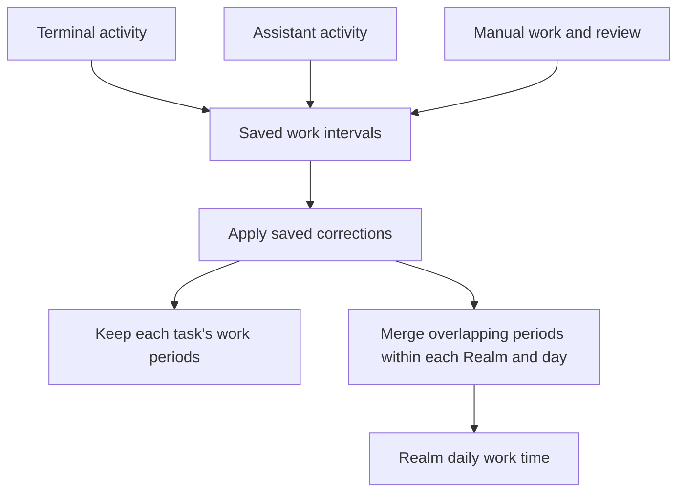

# Time and mana tracking: proposed design (Q01)

Status: the confirmed Realm daily-total rule is implemented on this task branch. [Daily work time in a Realm](realm-work-time.md) describes that implementation and its limits. The remaining Q01 capabilities below are proposals. Prepared by Codex on 2026-11-19, continuing the terminal session's [audit](time-tracking-audit.md).

Rohan clarified the Realm daily-total rule on 2026-11-19: merge overlapping work periods within each Realm. Task-level time is a separate measure and is not reduced to make task totals add up to the Realm total.

## Goal and limits

Record work on a quest when Rohan uses an AI assistant, works in a terminal or editor, or reviews and verifies a result. Preserve the evidence through restarts, show how totals were calculated, and let Rohan correct a mistake. Calculate each Realm's daily work time by merging its eligible work periods, so a minute contributes once to that Realm even when several tasks run together. Keep task-level measurements separate.

The scope is Q01.2 through Q01.9 from the note **Queue-Tea — Workspace Evolution & Development Intelligence**. Keep its child numbers as the capability map below. Filing more quests, changing Git workflows and redesigning the whole workspace are outside this change.

Existing constraints:

- Each worktree already identifies a Realm and quest. Several worktrees can be active together. A terminal's folder can change during a session.
- Saved records have daily totals without the intervals behind them. Those totals cannot reveal historical overlaps or kinds of work.
- The app and mod share the engine, but only the mod currently sees Claude Code's activity. Codex time is imported when a task returns.
- Mana displays the account's reported allowance. Estimated difficulty, recorded time and AI resource usage must stay separate.
- Rohan controls commits and pushes. This design requires no new dependency or external service.

## Capability map

| Child | Responsibility | Depends on |
| --- | --- | --- |
| Q01.1 | Existing audit | Complete as a draft; the quick-question routing cause still needs a live probe. |
| Q01.5 | Durable interval ledger, session identity and recovery | Existing record locking and atomic file replacement. |
| Q01.7 | Merge overlapping work periods into each Realm's daily total | Q01.5. |
| Q01.2 | Bind terminals and assistant sessions to a Realm and quest | Q01.5. |
| Q01.3 | Start and stop manual work and review without an AI conversation | Q01.2. |
| Q01.4 | Classify idle, paused and waiting periods | Q01.2 and Q01.3. |
| Q01.6 | Store attributable AI usage independently of time | Q01.5 and assistant adapters. |
| Q01.8 | Present reconciled breakdowns and existing difficulty estimates | Q01.7, classification and usage. |
| Q01.9 | Correct recorded intervals and their association | Q01.5 and Q01.7. |

Build the ledger and reconciliation rules first, then adapters and classification, then the views and corrections. These are capability boundaries for design review, not new queue entries or an implementation plan.

## Options

| Option | Cost and limit |
| --- | --- |
| Keep daily totals and patch the gap rule | Smallest patch, but still cannot explain overlaps, correct a time slot or recover a running session. It cannot satisfy Q01. |
| Keep evidence as intervals and calculate Realm totals from their union | Preserves concurrent task measurements and supports the confirmed Realm daily-total rule. Recommended. |
| Permit only one running tracker | Simpler accounting, but misses the AI work that carries on while Rohan works on another quest. |

Keep the observed intervals. Calculate the Realm total from their union; calculate task reports independently from the evidence associated with each task. AI runtime and resource usage remain available separately.

## Counting overlapping work

Use half-open intervals: a segment includes its start and excludes its end. Calculate the daily total separately for each Realm:

1. Apply saved corrections to the evidence.
2. Select that Realm's eligible work intervals, including its Elsewhere work. Exclude paused, idle, waiting and unconfirmed portions. Pausing one session does not stop another session that is working.
3. Clip the intervals to the requested day in the reporting timezone.
4. Sort them by start time and merge overlapping or touching periods.
5. Sum the lengths of the merged periods. Leave gaps between separate periods uncounted.

Do not assign an overlapping minute to a winning task. The task intervals keep their own attribution, and their reported durations can add up to more than the Realm total. Manual work does not shorten simultaneous AI work on another task, and selecting a quest does not take time away from another running quest. The detailed rules for each task's duration and activity breakdown remain a separate part of the design.

Each Realm is calculated independently. Work on another Realm does not reduce this Realm's time. If an all-Realms elapsed-time total is shown, calculate its own union across eligible Realm intervals; do not change either Realm's result to make their totals additive.

Rohan's example, with both tasks in the same Realm:

| Measure | Work period | Duration |
| --- | --- | --- |
| Task 1 | 1 pm to 4 pm | 3 hours |
| Task 2 | 2 pm to 5 pm | 3 hours |
| Realm daily total | 1 pm to 5 pm | 4 hours |

The task durations sum to 6 hours, while the Realm total is 4 hours. Both are valid measurements. For disjoint work periods of 9 am to 10 am and 2 pm to 3 pm, the Realm total is 2 hours; the gap between them is excluded.

## Evidence and proposed contracts

The following types are proposed contracts, not existing exports. Keep the domain rules in `hooks/shared/time/domain/`; file access belongs in its data layer. The app calls the engine through its existing API boundary, and assistant adapters call the same domain operations.

```ts
type WorkKind = 'ai' | 'manual' | 'review' | 'waiting' | 'idle' | 'paused'
type WorkTarget = { projectKey: string; taskId: string | null }
type WorkSource = 'claude' | 'codex' | 'terminal' | 'manual'

type TimeInterval = {
  id: string
  revision: number
  sessionId: string
  target: WorkTarget
  source: WorkSource
  kind: WorkKind
  startedAt: string
  confirmedUntil: string
  endedAt: string | null
}

type TimeCorrection = {
  id: string
  intervalId: string
  expectedRevision: number
  madeAt: string
  reason: string
  replacement: TimeInterval[]
}

type AiUsage = {
  id: string
  sessionId: string
  turnId: string
  target: WorkTarget
  provider: string
  model: string | null
  inputTokens: number | null
  outputTokens: number | null
  cacheReadTokens: number | null
  cacheWriteTokens: number | null
  reportedCost: { amount: number; currency: string } | null
}
```

An interval's target is fixed when it starts. Changing a binding closes it and opens another, so later task changes cannot move already recorded work. A null task means Elsewhere within the named Realm. An unbound external terminal is untracked until Rohan associates it; never guess a quest from a window title.

`confirmedUntil` is the latest saved evidence of ongoing work. A report never counts beyond it. `endedAt` closes the interval; an absent end does not authorize counting to the present. Validate timestamps, ordering, known kinds, finite nonnegative usage and the target at the engine boundary. Use UTC instants; use the configured reporting timezone only when splitting into local days.

The engine needs operations to bind a session, record activity, start or stop a kind, checkpoint ongoing work, read a breakdown and save a correction. Each mutation carries an operation ID stable across retries. Duplicate IDs with identical input replay the saved result; conflicting input fails. A session and turn ID identify usage so reimporting a log cannot count it twice.

Keep token fields in the provider's reported definitions. Missing usage is unknown, not zero. Never estimate per-quest usage by subtracting two account allowance percentages: another session could have consumed that allowance.

## Persistence and migration

Proposed destination: `~/.queue-tea/time/ledger.json`, a versioned ledger shared across Realms. It holds session bindings, intervals, usage, correction history and a monotonically increasing revision. It preserves the task evidence from which independent Realm totals and task reports can be calculated.

Use the repository's lock, backup and atomic replacement discipline from `hooks/shared/records/data/datasources/record_source.ts`. Preserve the most recent good ledger when parsing or writing fails. Serialize concurrent writes under the same lock, and never hold it while running a tool or waiting on an assistant. Each write either records the operation and result together or records neither.

Persist a binding, interval start, classification change, pause and stop immediately. Persist ongoing work at most 30 seconds apart. This bounds the normal crash gap to one checkpoint period; a failed write shows **Time could not be saved** and is retried with the same operation ID. Reading failure offers recovery from the last good copy and disables mutations until recovery succeeds.

Recovery closes an interrupted interval at its last saved confirmation. It preserves the binding but starts a fresh interval only after new activity or an explicit resume. Closing the app does not invent time until the next launch. An assistant that continues outside the app can still checkpoint through its adapter.

Migration is explicit and repeatable:

1. Capture a cutover instant and copy each Realm's existing task and Elsewhere daily totals once as legacy totals. Give the import a stable ID. Retain the original records and backups.
2. Label those totals **Earlier recorded time**. Their kind and overlap are unknown. Do not fabricate intervals from activity spans or claim that historical totals have been deduplicated.
3. Record new evidence only from the cutover onward. Clip imported assistant events to that boundary so a delayed Codex import cannot add pre-cutover time twice.
4. All updated views read the shared projection. The old daily fields can be refreshed as compatibility snapshots tagged with the ledger revision; a failed snapshot write is repaired from the ledger and never changes authoritative time.
5. Enable new tracking only after participating app and assistant writers support the ledger. Old writers must not keep adding daily counters alongside new tracking. Refuse an unsupported ledger version rather than overwrite it.

Legacy totals remain separately visible when a report combines old and new dates. Realm totals can merge overlaps only for ledger time after cutover; old daily task totals cannot reveal the Realm's historical union. A separate, explicit legacy-total adjustment can support correcting old totals without pretending their timing is known.

## Signals and classification

| Signal or action | Result |
| --- | --- |
| Bound assistant starts or finishes a turn or tool | Open or close AI evidence on its saved target. A tool can stay active beyond the human idle limit while its adapter confirms it is running. |
| A tracked terminal changes its working folder or quest | End its current interval and rebind prospectively. An unresolved folder asks for an association. |
| **Work manually** | Choose the quest and start manual tracking immediately, without a prompt to an assistant. |
| **Review / verify** | Change human focus and classification. A background automated test remains machine activity unless Rohan selects review. |
| No human activity for the configured idle limit | Close human active time at last activity plus the limit. A later event starts a new interval; the idle gap stays excluded. |
| **Waiting** or **Pause** | End that session's active interval immediately and record the excluded kind. |
| **Resume** | Start a fresh interval with its current binding. |
| `/clear` | Preserve the session binding, with no new attribution decision. |
| An errand | Split its interval from quest work and route it to that Realm's Elsewhere. Returning to the quest restores its binding explicitly. |

Use the existing configurable 15-minute idle limit as the initial default. Terminal input and foreground app interaction are human activity. A heartbeat proves that an adapter is alive, not that Rohan is working. File changes alone cannot extend human time because builds and assistants also write files. Work in an external editor requires **Work manually** plus a foreground user-idle signal; when that signal is unavailable, show the limitation and allow explicit start/stop and corrections. Do not infer hours of attention from a running process.

## Views and corrections

Add the measures to the existing Mana and quest detail surfaces before adding a new page. Show the Realm's daily work time as the union of its eligible work periods, separately from each task's time. Label the measures so a sum of task durations is never presented as the Realm total. Show waiting, idle and paused durations as excluded, and keep AI runtime and provider usage separate from time. Expected and actual difficulty keep their current units.

If the Realm view shows AI, manual and review durations, merge intervals within each kind independently and label the categories as overlapping. Their sum can exceed the Realm total. A task's own breakdown can be designed independently without changing the Realm calculation.

| State | What the user sees and can do |
| --- | --- |
| Loading | Progress indicator and **Reading tracked time…**. |
| Empty | **No tracked time yet**, with **Work manually** and session association. |
| Tracking | Current quest, kind, confirmed duration, **Pause**, **Waiting** and **Stop**. |
| Interrupted | Last confirmed time and **Resume**; downtime is excluded. |
| Failed | A plain explanation, the last saved result if available, and **Try again**. |
| Saving a correction | Busy state and disabled repeat submission. Keep the edited values on failure. |

The correction editor takes start, end, quest, kind and a reason. Validate fields on blur and submit, with errors beneath them. Start must precede end, dates must be valid, and the quest must belong to the selected Realm. Show a preview of the affected task measurements and Realm daily totals before saving. Moving time between tasks in the same Realm can change task measurements while leaving that Realm's total unchanged.

Save corrections as replacements with an audit trail. Keep original evidence. A correction's `expectedRevision` names the interval revision, so an unrelated heartbeat cannot invalidate an edit. Correct only closed intervals; stop a running segment before editing it. A stale editor reloads and shows a fresh preview instead of overwriting another correction. Recalculate affected Realm unions and task measurements under the ledger lock, and request a fresh preview if their affected totals changed. Replacement segments cannot overlap each other. Removing an interval uses an empty replacement. Applying the same correction twice changes totals once. Undo records a new correction; it does not erase history.

Use existing dialog focus and keyboard behaviour: labelled controls, Tab order matching the form, Enter to submit, Escape to cancel, and focus returned to the opener. Keep every action available on a narrow window by stacking fields. Announce validation and save errors through the existing accessible status pattern.



## Acceptance checks

- Bind two terminals to different quests. Rebind one while work continues. Recorded intervals keep their original quest; new intervals use the new one.
- Start manual work with no AI session. Confirm that it records, pauses, resumes and survives restarting the app without charging downtime.
- Run Rohan's example above. Retain 3 hours on each task and show 4 hours as that Realm's daily total. Reverse event order and duplicate a delivery: the totals stay the same.
- Record work from 9 am to 10 am and 2 pm to 3 pm in one Realm. Its daily total is 2 hours. Cover nested and touching intervals as well as overlaps.
- Run overlapping intervals in two Realms. Calculate each Realm independently; selecting or working in one does not reduce the other's total.
- Overlap manual work with AI work on another task in the same Realm. Preserve both tasks' evidence and count the overlapping period once in the Realm total, with no priority between kinds.
- Keep an assistant tool active for 20 minutes with confirmations. Record all 20. Leave a human tracker idle for 20 minutes with a 15-minute limit. Record 15 and exclude 5.
- Crash between checkpoints and during a write. Recover the last good state, close at the saved confirmation and replay a retried operation once. Test two concurrent writers.
- Import one legacy record and one Codex log twice. Preserve legacy totals once; count only eligible post-cutover evidence once. Show unknown usage as unknown.
- Split an interval across midnight and a daylight-saving transition. Totals across days equal the original duration; an offset change creates no extra time.
- Leave a timer running without assistant usage. Allowance and usage do not change. Import usage from two assistants without assigning account-wide changes to either quest.
- Correct an interval's time and quest. Reject invalid or stale edits, persist the correction, recalculate every affected view, and undo with history intact.
- Exercise loading, empty, interrupted and failed states, keyboard focus, a narrow window and retry after a failed save.

Use pure domain tests for day splitting, interval unions, idle rules and correction validation. Use the existing fake host for persistence, migration and concurrent writers. App integration tests should cross the engine API and saved ledger; one browser flow should cover manual tracking, pause, restart and correction. Exact commands remain those in the repository's `CLAUDE.md`. The implemented Realm-total subset and its focused verification are documented in [daily work time in a Realm](realm-work-time.md); the broader acceptance list is not a claim that all of Q01 is complete.

## Confirmed counting rule

Each Realm's daily work time is the union of its eligible work periods. Task measurements stay separate and can sum to more than the Realm total. Rohan's 1 pm to 4 pm and 2 pm to 5 pm example must show 4 Realm hours and preserve both tasks' 3-hour periods.

## Remaining design details

- Use a shared interval ledger with a one-time legacy baseline. Daily totals remain readable, with their historical uncertainty visible.
- Checkpoint every 30 seconds and retain the existing 15-minute human idle default. These are initial defaults to verify with representative sessions.
- Settle the task-level duration and breakdown definitions separately from the confirmed Realm-total rule.

The foreground user-idle signal for external editors and the assistant lifecycle events still need an implementation spike. Verify the capabilities actually exposed by each installed adapter before promising automatic tracking outside the app. Q03's adaptive verification policy is a roadmap prerequisite; reconcile its current status before setting the implementation checks.
